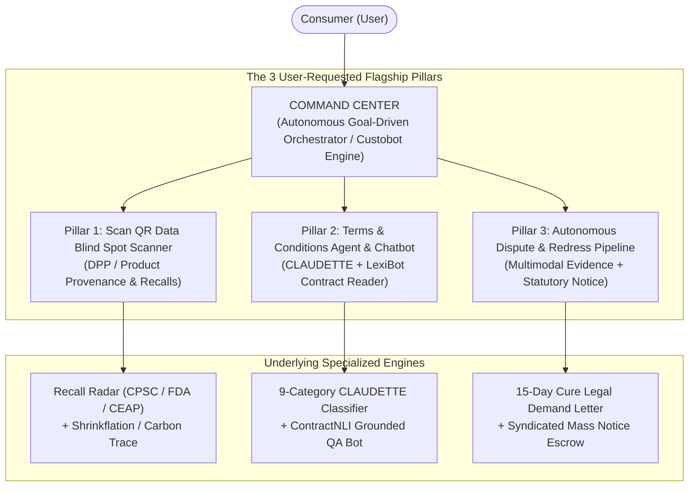

# Comprehensive Consumer Rights & Awareness Platform: Integrated Feature Specification

## 1. System Vision & The Three New Flagship Pillars

Based on user requirements and computational legal scholarship, the platform integrates three foundational pillars alongside real-time web audits:

---

## 2. In-Depth Feature Blueprints & Academic Grounding

---

### FEATURE 1: "Scan QR" — Product History, Recalls & Data Blind Spot Engine
> *"Tells all the data blind spots, hidden recalls, supply chain provenance, and product history with a single scan."*

#### The Problem Addressed
When consumers purchase physical goods or packaged products, product labels exhibit extreme informational asymmetry. Critical data—such as active safety recalls, stealth ingredient cheapening ("skimpflation"), net-weight reduction ("shrinkflation"), third-party white-label origins, and repairability indices—are completely hidden behind marketing slogans.

#### Academic & Regulatory Foundation
1. **Digital Product Passport (DPP) & Dynamic dDPPs Frameworks:**
   * Grounded in the European Union’s **Ecodesign for Sustainable Products Regulation (ESPR)** and **Circular Economy Action Plan (CEAP)**.
   * Research on *Dynamic Digital Product Passports (dDPPs)* (Surrey / MDPI 2025/2026) demonstrates that serialized 2D barcodes/QR codes linking to live regulatory and IoT data allow instantaneous identification of hazardous batches, preventing prolonged consumer exposure to defective goods.
2. **Item-Level Traceability vs. Batch Apathy:**
   * Research shows traditional UPC barcodes fail to communicate recall specificity, causing either mass consumer panic or complete recall neglect. Serialized QR resolution bridges this transparency gap.

#### Concrete System Functionality
* **Instant QR / Barcode Scan Interface:** Camera-enabled scanner and manual barcode lookup supporting GS1 QR codes, UPC-A, and EAN-13.
* **Recall & Safety Audit:** Automatically queries live APIs from safety regulators (CPSC - Consumer Product Safety Commission, FDA, and EU Safety Gate). If the scanned product or specific production lot is subject to an active safety recall or fire hazard alert, high-priority emergency instructions and return voucher links are rendered.
* **Supply Chain & Manufacturer "Blind Spot" Unmasking:**
  * Resolves true parent corporate ownership (e.g., exposing that 10 different budget appliance brands are manufactured by a single white-label OEM).
  * Unmasks country-of-origin hops and raw material provenance.
* **Shrinkflation & Formulation History:**
  * Compares historical net weight and price per unit over time (e.g., *"Package reduced from 450g to 380g in Nov 2025 while maintaining \$8.99 sticker price — a hidden 18.4% unit price inflation"*).
* **Repairability & Environmental Lifecycle Index:**
  * Outputs a 1–10 Repairability Rating (availability of spare parts, disassembly ease, software lockouts) based on French Repairability Index and Right to Repair statutory standards.

---

### FEATURE 2: Terms and Conditions Agent & Interactive Chatbot ("LexiBot")
> *"Dedicated legal contract agent that ingests agreements, highlights traps, scores fairness, and answers consumer questions interactively."*

#### The Problem Addressed
Standard-form click-wrap adhesion contracts impose an impossible cognitive tax: reading annual consumer policies requires 244 hours per person (\$365B economic drag; McDonald & Cranor 2008). Corporations exploit this to bury unilateral alteration clauses, mandatory arbitration waivers, and blanket liability exclusions.

#### Academic & Legal NLP Foundation
1. **The "Appointed LLM Reader" Paradigm:**
   * **Pałka, Lagioia, Liepiņa, Lippi, & Sartor (Artificial Intelligence and Law 2025 - *Make privacy policies longer and appoint LLM readers*):** Establishes that shortening contracts creates dangerous ambiguity; instead, consumers must appoint dedicated LLM reader agents who ingest the exhaustive text and act as defensive proxies.
2. **Supervised Unfair Clause Classification:**
   * **Lippi et al. (Artificial Intelligence and Law 2019 - *Project CLAUDETTE*):** Codified the 9 core categories of unfair consumer contract terms under EU Directive 93/13/EEC.
   * **Chalkidis et al. (ACL 2022 - *LexGLUE / UNFAIR-TOS*):** Proved domain-pretrained `Legal-BERT` achieves state-of-the-art precision for automated consumer contract auditing.
3. **Document-Level Natural Language Inference & Grounded QA:**
   * **Koreeda & Manning (EMNLP 2021 - *ContractNLI*):** Testing specific consumer rights hypotheses against contracts with verbatim evidence span attribution.
   * **Harkous et al. (USENIX Security 2018 - *Polisis & PriBot*):** Hierarchical data practice modeling and free-form conversational question answering over legal policies.

#### Concrete System Functionality
* **Contract Ingestion Pipeline:** Paste contract text, drop a terms/privacy policy URL, or upload PDF/DOCX agreements.
* **CLAUDETTE 9-Category Trap Audit:**
  * Highlights red-flag sentences across: *Unilateral change of terms, Unilateral change of service, Unilateral termination, Limitation of liability, Arbitration waivers, Choice of foreign jurisdiction, Content licensing overreach, Browse-wrap formation, and Unilateral indemnity*.
* **Fairness Grade (A–F) & Multi-Axial Risk Radar:**
  * Generates an overall 0–100 fairness index and an interactive SVG/Recharts 5-axis Radar chart benchmarking *Dispute Rights, Account Security, Liability Balance, Data Sovereignty, and Change Transparency*.
* **Interactive Legal Chatbot ("LexiBot"):**
  * Consumers chat directly with the agent in plain language:
    * *"Can they cancel my subscription without notice?"*
    * *"Am I giving up my right to join a class-action lawsuit?"*
    * *"Do they sell my location and browsing data to third parties?"*
    * *"What fees do they charge if I cancel early?"*
  * **Strict Grounding:** LexiBot returns a direct, plain-English verdict, accompanied by the verbatim contract excerpt, section reference, and a plain-language explanation of why the term is standard, aggressive, or legally predatory.

---

### FEATURE 3: The Autonomous Consumer "Command Center"
> *"The centralized hub where the user describes their grievance or goal in natural language, and autonomous subagents orchestrate and complete all the required work."*

#### The Problem Addressed
When consumers suffer real-world economic injuries (e.g., unfair refusal of warranty repair, uncancelled recurring subscriptions, damaged online goods, hidden fees), they do not know what laws apply, what forms to fill out, how to calculate damages, or how to write an enforceable pre-dispute notice. 

#### Academic Foundation & Agentic Theory
1. **The "Custobot Economy" & Consumer Law for AI Agents:**
   * **Consumer Law Scholars Conference (Boston University 2025/2026):** Models the paradigm shift from passive search tools to autonomous goal-directed agents ("Custobots") acting on behalf of consumers.
2. **Delegation-Augmented Consumer Decision Journey (DA-CDJ 2026):**
   * Establishes the three-tier agentic delegation loop: (1) Goal Specification, (2) Multi-Agent Orchestration & Decomposition, and (3) Human Post-Delegation Audit & Authorization.
3. **The "Fourth Party" in Dispute Resolution:**
   * **Wing, Martinez, Katsh, & Rule (Negotiation Journal 2021) & Schmitz (Pepperdine Law Review 2012):** Algorithmic technology acts as an active fourth party that extracts evidence, frames statutory claims, and generates pre-litigation cure notices to eliminate the "squeaky wheel" barrier.

#### Concrete System Functionality & Orchestration Loop
1. **Natural Language Requirement Intake:**
   * User enters a plain-English prompt or voice note:
     > *"I bought a smart TV 5 months ago from TechMart. The display motherboard burned out yesterday, and customer service claims the warranty only covers 'manufacturing defects within 90 days' and refused a refund or repair. Here is my receipt and chat screenshot."*
2. **Autonomous Intent Parsing & Issue Spotting:**
   * Deconstructs the requirement into legal entities:
     * *Transaction:* Smart TV, \$649.00, purchased 5 months prior.
     * *Defect Manifestation:* Total hardware failure within reasonable product lifespan.
     * *Merchant Position:* Unlawful disclaimer of statutory implied warranty.
     * *Governing Law:* Uniform Commercial Code (UCC § 2-314 - Implied Warranty of Merchantability) and Consumer Protection Act (unfair limitation of statutory warranty periods).
3. **Automated Multi-Agent Task Delegation:**
   * **Agent 1 (Evidence Ingestion & OCR):** Extracts invoice dates, serial numbers, payment reference, and customer service refusal quotes.
   * **Agent 2 (Damage Calculator):** Computes total claim: \$649.00 purchase price + \$38.94 statutory interest (6% per annum) + \$45.00 diagnostic inspection fee = **\$732.94 total demand**.
   * **Agent 3 (Statutory Notice Generator):** Generates an authoritative, formal **Pre-Dispute Notice & Statutory Demand Letter**, setting a legally enforceable 15-day cure window, complete with an indexed and SHA-256 hashed evidentiary exhibit packet.
   * **Agent 4 (Regulatory & Escalation Scheduler):** Pre-fills complaint forms for the FTC and state consumer protection bureau, setting an automated 15-day reminder to submit if the merchant fails to remediate.
4. **Action Bundle Delivery:**
   * Presents the user with an executive summary and one-click actions:
     * `[Download / Print Formal Legal Notice (PDF)]`
     * `[Copy Registered Agent Email Notice]`
     * `[Track 15-Day Cure Countdown]`
     * `[File Regulatory Complaint with One Click]`

---

## 3. Synergy with the Core Detection & Watchdog Features

| Flagship Pillar | Integrates With | Multiplier Effect |
|---|---|---|
| **Scan QR (Data Blind Spots)** | **ReviewTruth & DripShield** | When a QR code is scanned, the engine checks for fake reviews, hidden shrinkflation trends, and active safety recalls simultaneously. |
| **Terms & Conditions Agent** | **DeceptiveShield** | LexiBot links directly with live webpage scans, warning users before they sign up for subscription traps or waive their legal rights. |
| **Command Center** | **Syndicated Claim Escrow** | If the Command Center detects that multiple users are filing identical grievances against the same merchant, it offers to syndicate their claims into a mass pre-dispute notice campaign. |
