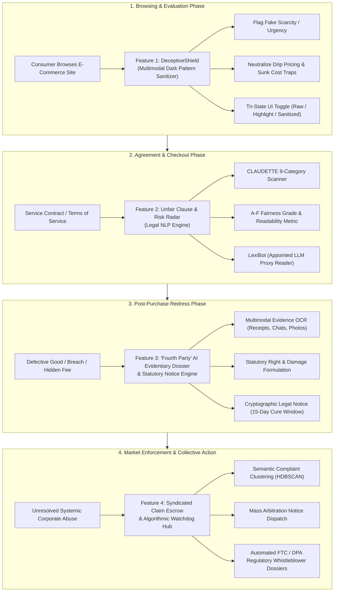

# Hackops-CR: AI-Powered Consumer Rights & Awareness Platform
> **Empirically Grounded System Architecture & Feature Blueprint Synthesized via Multi-Agent Academic Research**

## 1. Executive Summary & Subagent Methodology

Modern digital commerce presents systemic procedural, cognitive, and informational asymmetries between consumers and commercial platforms. To formulate a research-grounded consumer advocacy and awareness platform, three specialized autonomous research subagents were dispatched:

```
                                  +-------------------------------------------------------+
                                  |                 COORDINATING AGENT                    |
                                  +-------------------------------------------------------+
                                            /                  |                 \
                                           /                   |                  \
                                          v                    v                   v
                +---------------------------------+  +-------------------+  +---------------------------------+
                |           SUBAGENT 1            |  |    SUBAGENT 2     |  |           SUBAGENT 3            |
                |  Dark Patterns & Deceptive UX   |  |     Legal NLP     |  | Consumer Redress & Dispute Res. |
                |  (HCI / Empirical Legal Studies)|  | & Contract Models |  | (ODR / Procedural Justice)      |
                +---------------------------------+  +-------------------+  +---------------------------------+
```

1. **Subagent 1 (Dark Patterns & Deceptive UX):** Investigated behavioral conversion lift, manipulative UI taxonomies, and multimodal automated detection (ACM CHI, CSCW, IEEE/ACM ICSE).
2. **Subagent 2 (Legal NLP & Terms Analysis):** Investigated unfair adhesion contract clauses, privacy policy comprehension, and "appointed LLM reader" paradigms (Project CLAUDETTE, USENIX Security, ACL, Artificial Intelligence & Law).
3. **Subagent 3 (Consumer Redress & Dispute Resolution):** Investigated Online Dispute Resolution (ODR) "Fourth Party" theory, the "Squeaky Wheel" empirical settlement gap, and collective claim aggregation (Stanford Law Review, Pepperdine Law Review, Harvard/ABA Negotiation).

---

## 2. Integrated Platform Architecture



---

## 3. Four Core Features Grounded in Academic Research

---

### FEATURE 1: "DeceptiveShield" — Real-Time Multimodal Dark Pattern Detector & UI Sanitizer

#### The Problem
E-commerce websites systematically deploy manipulative interface elements that exploit human cognitive biases—such as false countdown timers, drip pricing, sneaked basket additions, and confirmshaming. Over 95% of mobile apps and 11% of top e-commerce websites contain deceptive design, with 55% of consumers unable to identify them unaided.

#### Academic Foundation & Literature Grounding
* **Mansur et al. (IEEE/ACM ICSE 2023 - *AidUI*):** Proved that text-only heuristics fail to identify dark patterns because deception relies on visual hierarchy (low luminance buttons, hidden cancel paths). Developed multimodal fusion combining computer vision (Faster R-CNN / UIED) and contextual language transformers on the `CONTEXTDP` benchmark.
* **Schäfer et al. (ACM CHI 2024 - *Fighting Malicious Designs*):** Empirically tested client-side visual countermeasures across 13 dark pattern categories, demonstrating the efficacy of a **Tri-State Countermeasure System** (Highlighting, Hiding/Stripping, and Toggling).
* **Mathur et al. (ACM CSCW 2019 - *Dark Patterns at Scale*):** Discovered through a crawl of 11,000 shopping sites that countdown clocks and false scarcity triggers are syndicated by 22 third-party SaaS vendors and frequently rely on JavaScript looping.
* **Di Geronimo et al. (ACM CHI 2020):** Demonstrated that while 55% of consumers suffer from dark pattern blindness unaided, real-time contextual educational cueing sharply restores resistance.

#### Technical Implementation & Functionality
1. **Multimodal Client-Side Scanner:**
   * Ingests the live DOM and computed styles using `MutationObserver`.
   * **Semantic Text Classifier (DistilBERT):** Classifies manipulative copy (confirmshaming, artificial scarcity).
   * **Visual Hierarchy Heuristics:** Measures button surface area and contrast ratios (WCAG luminance) between affirmative and negative options (e.g., detecting primary CTA buttons with 9:1 contrast next to "Decline" links with <1.5:1 contrast).
   * **Script Execution Monitor:** Traces `setInterval` and `localStorage` mutations to identify synthetic countdown timers that reset upon page refresh.
2. **Tri-State Countermeasure Interface:**
   * *Highlight & Educate:* Outlines manipulative elements in high-visibility amber/red badges with tooltips explaining the cognitive vulnerability targeted.
   * *Sanitize & Strip:* Automatically unchecks pre-selected add-on checkboxes, suppresses synthetic urgency clocks, and balances button contrast.
   * *Diff Toggle:* Provides a hotkey switch allowing the user to view the split-screen comparison between the manipulative interface and the sanitized layout.

---

### FEATURE 2: "Unfair Clause & Risk Radar" — Automated Contract & Terms Auditor

#### The Problem
Standard-form consumer agreements (click-wrap and browse-wrap adhesion contracts) create an illusory "Notice and Choice" regime. Consumers would require 244 hours annually to read the policies they encounter, and corporations exploit this barrier to slip in one-sided terms, arbitration bans, and blanket liability waivers.

#### Academic Foundation & Literature Grounding
* **Lippi et al. (Artificial Intelligence and Law 2019 - *Project CLAUDETTE*):** Formulated the definitive 9-category taxonomy of potentially unfair consumer clauses under EU Directive 93/13/EEC and trained supervised neural models achieving 0.75–0.85 F1 scores.
* **Chalkidis et al. (ACL 2022 - *LexGLUE / UNFAIR-TOS*):** Standardized legal NLP benchmarks and proved that domain-pretrained transformers (`Legal-BERT`) identify subtle legal rights deprivations with state-of-the-art precision.
* **McDonald & Cranor (I/S: Journal of Law and Policy 2008):** Empirically proved the economic impossibility of manual contract review: an annualized \$365B macroeconomic productivity loss if consumers read every policy.
* **Pałka, Lagioia, Liepiņa, Lippi, & Sartor (Artificial Intelligence and Law 2025):** Established that shortening agreements causes legal ambiguity; instead, consumers must appoint autonomous **"LLM Reader"** agents to analyze full texts.
* **Koreeda & Manning (EMNLP 2021 - *ContractNLI*):** Formalized document-level Natural Language Inference for contracts, testing specific legal hypotheses with span-level evidence attribution.

#### Technical Implementation & Functionality
1. **CLAUDETTE 9-Category Clause Classifier:**
   * Evaluates input contracts against the 9 key unfair categories:
     1. Unilateral change of terms
     2. Unilateral change of service
     3. Unilateral contract termination / suspension
     4. Blanket limitation of merchant liability
     5. Mandatory individual arbitration / waiver of court access
     6. Mandatory jurisdiction / choice of foreign law
     7. Excessive IP assignment of user content
     8. Contract formed merely by browsing
     9. Unilateral consumer indemnification
2. **Fairness Grade (A–F) & Multi-Axial Risk Radar:**
   * Calculates an overall Consumer Fairness Grade (0–100) based on weighted clause severity.
   * Displays an interactive 5-axis Radar Chart benchmarking the service against industry averages: *Dispute Rights, Account Retention, Liability Balance, Data Ownership, and Change Notification*.
3. **"LexiBot" Appointed LLM Reader:**
   * Allows the consumer to ask plain-language questions (*"Can they cancel my subscription without refunding my pre-paid balance?"*).
   * Executes ContractNLI hypothesis verification: returns a verdict (**Entailed / Contradicted / Neutral**) grounded in verbatim clause citations.

---

### FEATURE 3: The "Fourth Party" AI Evidentiary Dossier & Automated Statutory Notice Engine

#### The Problem
Under the "Squeaky Wheel" trap, over 90% of consumers abandon valid warranty, refund, and service deficiency claims because drafting a formal, legally grounded demand letter requires prohibitive legal literacy. Companies systematically exploit this friction to resolve claims only for aggressive or legally literate claimants.

#### Academic Foundation & Literature Grounding
* **Schmitz (Pepperdine Law Review 2012 - *Access to Consumer Remedies in the Squeaky Wheel System*):** Provided empirical evidence that corporate complaint handling is regressive: only assertive, articulate consumers obtain informal remedies, leaving vulnerable consumers with uncompensated losses.
* **Wing, Martinez, Katsh, & Rule (Negotiation Journal 2021 - *The Rise of the Fourth Party*):** Traced the evolution of technology in dispute resolution from a passive communication channel to an active "Fourth Party"—an algorithmic agent performing issue framing, evidence triage, and claim automation.
* **Schmitz & Rule (American Bar Association 2017 - *The New Handshake: Online Dispute Resolution*):** Designed the architectural blueprint for modern multi-tier consumer ODR, combining automated pre-dispute negotiation, structured mediation, and enforceable remedy paths.
* **Katsh & Rabinovich-Einy (Oxford University Press 2017 - *Digital Justice*):** Established that digital commerce generates disputes at a volume requiring automated evidence compilation and proactive dispute prevention.

#### Technical Implementation & Functionality
1. **Multimodal Evidence Ingestion (OCR & Entity Extraction):**
   * Consumers upload proof artifacts: invoice PDFs, customer service chat screenshots, rejection emails, and photographs of defective products.
   * Named-Entity Recognition (NER) extracts merchant legal names, transaction dates, defect onset dates, and previous support responses.
2. **Automated Statutory Rights & Damage Formulation:**
   * Matches the facts against statutory protections (e.g., statutory implied warranties of merchantability, Consumer Protection Acts, deficiency of service regulations).
   * Computes the exact recoverable sum: purchase price + statutory interest + incidental out-of-pocket costs.
3. **Statutory Demand Letter & Cryptographic Exhibit Dossier Generator:**
   * Synthesizes an authoritative, professionally formatted **Legal Pre-Dispute Notice / Statutory Demand Letter** citing relevant legal provisions and establishing a mandatory 15-day cure window.
   * Bundles all uploaded evidence into an indexed, cryptographically hashed and timestamped PDF exhibit packet.
4. **Graduated Redress Escalation Tracker:**
   * Maintains an active cure-window countdown.
   * If the merchant fails to respond or refuses remediation, one click auto-fills the formal complaint paperwork for the jurisdiction's national consumer protection agency, ombudsman, or small claims tribunal.

---

### FEATURE 4: Syndicated Claim Escrow & Algorithmic Watchdog Hub

#### The Problem
Modern algorithmic commerce distributes micro-injuries (such as \$15 covert fees, deceptive warranty rejections, or dynamic price discrimination) across millions of consumers. Individual litigation is economically irrational, and corporate mandatory arbitration clauses neutralize traditional class-action lawsuits.

#### Academic Foundation & Literature Grounding
* **Glover (Stanford Law Review 2022 - *Mass Arbitration*):** Proved how coordinated dispute filings flip corporate bargaining leverage. When thousands of consumers file synchronized individual arbitration demands, the corporate defendant is confronted with millions of dollars in mandatory administrative filing fees, compelling equitable systemic settlement.
* **Bar-Gill (University of Chicago Law Review 2019 - *Algorithmic Price Discrimination*):** Demonstrated that predictive algorithms exploit consumer cognitive misperceptions and urgency blindspots through individualized pricing that cannot be proven by any single consumer in isolation.
* **Luguri & Strahilevitz (Journal of Legal Analysis 2021):** Quantified behavioral harm in controlled trials, showing that subtle deception doubles conversion lift without brand backlash, and formulated metrics to quantify aggregate consumer damages under FTC Act Section 5 standards.

#### Technical Implementation & Functionality
1. **Crowdsourced Telemetry & Pricing Ingestion:**
   * Users submit pricing snapshots (price, timestamp, geolocation, browser/OS fingerprint) or standardized denial letters (e.g., "Merchant claims cracked hinge is user damage on laptop model X").
2. **Semantic NLP Clustering & Anomaly Detection:**
   * Applies sentence embeddings (e.g., `all-MiniLM-L6-v2`) and unsupervised density clustering (`HDBSCAN`) to detect systemic corporate rejection scripts and covert dynamic price inflation across different demographics.
3. **Tiered Collective Action Escalation:**
   * **Tier 1 (Public Algorithmic Scorecard):** When corroborated reports cross a statistical significance threshold (e.g., 50+ verified complaints), the platform publishes a public Watchdog Audit Report detailing the anomaly.
   * **Tier 2 (The Syndicated Notice Escrow):** Implementing Glover's *Mass Arbitration* framework, affected consumers join a unified campaign. Upon reaching critical mass, the platform dispatches hundreds of simultaneous individualized legal demand notices to the merchant's corporate compliance registered agent, overcoming arbitration immunity.
   * **Tier 3 (Regulatory Export):** Automatically compiles anonymized aggregate telemetry dossiers and transmits them to federal regulators (FTC, CFPB, national consumer commissions) for statutory enforcement proceedings.

---

## 4. Academic Citation Matrix & Primary Sources

| # | Reference & Citation | Publication Venue | Core Focus & Methodology | Operationalized Feature |
|---|---|---|---|---|
| 1 | **Mansur, S. M. H., Salma, S., Awofisayo, D., & Moran, K. (2023).** *AidUI: Toward Automated Recognition of Dark Patterns in User Interfaces.* | IEEE/ACM 45th International Conference on Software Engineering (ICSE '23), pp. 1957–1969. [DOI: 10.1109/ICSE48619.2023.00165](https://doi.org/10.1109/ICSE48619.2023.00165) | Multimodal CV + NLP architecture on GUI/DOM elements. | **Feature 1:** Real-time DOM pattern scanner. |
| 2 | **Schäfer, R., Preuschoff, P. M., Röpke, R., Sahabi, S., & Borchers, J. (2024).** *Fighting Malicious Designs: Towards Visual Countermeasures Against Dark Patterns.* | Proceedings of the 2024 CHI Conference on Human Factors in Computing Systems (CHI '24), Article 579, pp. 1–17. [DOI: 10.1145/3613904.3642732](https://doi.org/10.1145/3613904.3642732) | Empirical validation of client-side Tri-State remediation (Highlight, Strip, Toggle). | **Feature 1:** Tri-State Sanitizer & UI toggle engine. |
| 3 | **Gray, C. M., Kou, Y., Battles, B., Hoggatt, J., & Toombs, A. L. (2018).** *The Dark (Patterns) Side of UX Design.* | Proceedings of the 2018 CHI Conference on Human Factors in Computing Systems (CHI '18), Paper 534, pp. 1–14. [DOI: 10.1145/3173574.3174108](https://doi.org/10.1145/3173574.3174108) | Foundational 5-part taxonomy of digital dark patterns. | **Feature 1:** Taxonomy and cognitive vulnerability categorization. |
| 4 | **Di Geronimo, L., Braz, L., Fregnan, E., Palomba, F., & Bacchelli, A. (2020).** *UI Dark Patterns and Where to Find Them: A Study on Mobile Applications and User Perception.* | Proceedings of the 2020 CHI Conference on Human Factors in Computing Systems (CHI '20), pp. 1–14. [DOI: 10.1145/3313831.3376600](https://doi.org/10.1145/3313831.3376600) | Audit of 240 apps; 55% user detection blindness; training cues restore awareness. | **Feature 1:** Contextual educational tooltips. |
| 5 | **Lippi, M., Pałka, P., Contissa, G., Lagioia, F., Micklitz, H.-W., Sartor, G., & Torroni, P. (2019).** *CLAUDETTE: an automated detector of potentially unfair clauses in online terms of service.* | Artificial Intelligence and Law, 27(2), pp. 117–139. [DOI: 10.1007/s10506-019-09243-2](https://doi.org/10.1007/s10506-019-09243-2) | Sentence-level 9-category classification under EU consumer protection directives. | **Feature 2:** Core clause classification engine. |
| 6 | **Chalkidis, I., Jana, A., Hartung, D., et al. (2022).** *LexGLUE: A Benchmark Dataset for Legal Language Understanding in English.* | Proceedings of the 60th Annual Meeting of the ACL (Volume 1), pp. 4310–4330. [DOI: 10.18653/v1/2022.acl-long.297](https://doi.org/10.18653/v1/2022.acl-long.297) | Domain-adapted Legal-BERT benchmarks on unfair terms. | **Feature 2:** High-precision Legal-BERT scoring backbone. |
| 7 | **McDonald, A. M., & Cranor, L. F. (2008).** *The Cost of Reading Privacy Policies.* | I/S: A Journal of Law and Policy for the Information Society, 4(3), pp. 543–568. [Ohio State University Knowledge Bank](https://kb.osu.edu/handle/1811/72839) | Macroeconomic quantification of reading time (244 hrs/yr; \$365B annual cost). | **Feature 2:** Readability index and "Reading Time Saved" metric. |
| 8 | **Pałka, P., Lagioia, F., Liepiņa, R., Lippi, M., & Sartor, G. (2025).** *Make privacy policies longer and appoint LLM readers.* | Artificial Intelligence and Law. [DOI: 10.1007/s10506-025-09442-0](https://doi.org/10.1007/s10506-025-09442-0) | Theory of appointed LLM reader agents as consumer proxies. | **Feature 2:** LexiBot appointed proxy reader. |
| 9 | **Koreeda, Y., & Manning, C. D. (2021).** *ContractNLI: A Dataset for Document-level Natural Language Inference for Contracts.* | Findings of the Association for Computational Linguistics: EMNLP 2021, pp. 1907–1919. [DOI: 10.18653/v1/2021.findings-emnlp.164](https://doi.org/10.18653/v1/2021.findings-emnlp.164) | Document-level NLI for hypothesis verification and negation-by-exception handling. | **Feature 2:** Grounded contract question answering. |
| 10 | **Harkous, H., Fawaz, K., Lebret, R., Schaub, F., Shin, K. G., & Aberer, K. (2018).** *Polisis: Automated Analysis and Presentation of Privacy Policies Using Deep Learning.* | Proceedings of the 27th USENIX Security Symposium (USENIX '18), pp. 531–548. [USENIX Presentation](https://www.usenix.org/conference/usenixsecurity18/presentation/harkous) | Hierarchical data practice classification & PriBot conversational QA. | **Feature 2:** Standardized Privacy Nutrition Cards. |
| 11 | **Schmitz, A. J. (2012).** *Access to Consumer Remedies in the Squeaky Wheel System.* | Pepperdine Law Review, 39(2), pp. 279–366. [Pepperdine Digital Commons](https://digitalcommons.pepperdine.edu/plr/vol39/iss2/2/) | Empirical evidence that corporations settle only with aggressive consumers. | **Feature 3:** Universal automated statutory notice generation. |
| 12 | **Wing, L., Martinez, J., Katsh, E., & Rule, C. (2021).** *Designing Ethical Online Dispute Resolution Systems: The Rise of the Fourth Party.* | Negotiation Journal, 37(1), pp. 49–64. [DOI: 10.1111/nejo.12350](https://doi.org/10.1111/nejo.12350) | The Fourth Party concept in algorithmic dispute structuring and triage. | **Feature 3:** AI Evidentiary Dossier & claim orchestrator. |
| 13 | **Schmitz, A. J., & Rule, C. (2017).** *The New Handshake: Online Dispute Resolution and the Future of Consumer Protection.* | American Bar Association (Dispute Resolution Section). ISBN: 978-1634259163. | Architectural blueprint for tiered consumer ODR systems. | **Feature 3:** Multi-tiered dispute escalation pipeline. |
| 14 | **Katsh, E., & Rabinovich-Einy, O. (2017).** *Digital Justice: Technology and the Internet of Disputes.* | Oxford University Press. [DOI: 10.1093/acprof:oso/9780190464585.001.0001](https://doi.org/10.1093/acprof:oso/9780190464585.001.0001) | Algorithmic dispute scaling and dispute prevention mechanisms. | **Feature 3:** Pre-dispute evidence compiler. |
| 15 | **Glover, J. M. (2022).** *Mass Arbitration.* | Stanford Law Review, 74(6), pp. 1283–1383. [Stanford Law Review](https://www.stanfordlawreview.org/print/article/mass-arbitration/) | Doctrine of mass dispute filing to overcome corporate arbitration waivers. | **Feature 4:** Syndicated Claim Escrow & mass dispatch. |
| 16 | **Bar-Gill, O. (2019).** *Algorithmic Price Discrimination When Demand Is a Function of Both Preferences and (Mis)perceptions.* | The University of Chicago Law Review, 86(2), pp. 217–254. [Chicago Unbound](https://chicagounbound.uchicago.edu/uclrev/vol86/iss2/12/) | Law & economics analysis of cognitive exploitation in dynamic pricing. | **Feature 4:** Algorithmic pricing watchdog telemetry. |
| 17 | **Luguri, J., & Strahilevitz, L. J. (2021).** *Shining a Light on Dark Patterns.* | Journal of Legal Analysis, 13(1), pp. 43–109. [DOI: 10.1093/jla/laaa006](https://doi.org/10.1093/jla/laaa006) | Controlled study ($N=1,963$); quantified conversion lift (2x-4x); FTC Section 5 nexus. | **Feature 4:** Annual Consumer Loss Index (ACLI) modeler. |
| 18 | **Mathur, A., Acar, G., Friedman, M. J., et al. (2019).** *Dark Patterns at Scale: Findings from a Crawl of 11K Shopping Websites.* | Proceedings of the ACM on Human-Computer Interaction, 3(CSCW), Article 81, pp. 1–32. [DOI: 10.1145/3359183](https://doi.org/10.1145/3359183) | Automated crawl of 53k pages; identified 22 turnkey third-party vendor scripts. | **Feature 4:** Deceptive vendor fingerprinting registry. |

---

## 5. Technology Stack Recommendations

* **Frontend:** Next.js / React (App Router), TailwindCSS, Web Extensions API (Manifest V3 for Chrome/Firefox client-side DOM scanner), Lucide Icons, Recharts (Radar charts).
* **Machine Learning / NLP Services:**
  * Clause Classification: Hugging Face Transformers (`nlpaueb/legal-bert-base-uncased` fine-tuned on CLAUDETTE / UNFAIR-TOS).
  * Evidence Inference: `ContractNLI` cross-encoder for hypothesis checking.
  * Dark Pattern Multimodal Classifier: Lightweight ONNX-runtime DistilBERT running directly in-browser.
  * Clustering: `HDBSCAN` + `sentence-transformers/all-MiniLM-L6-v2` for crowdsourced complaint clustering.
* **Backend & Storage:** FastAPI / Python, PostgreSQL with `pgvector` extension for semantic search, Supabase / AWS S3 for cryptographically signed PDF evidence dossiers.

