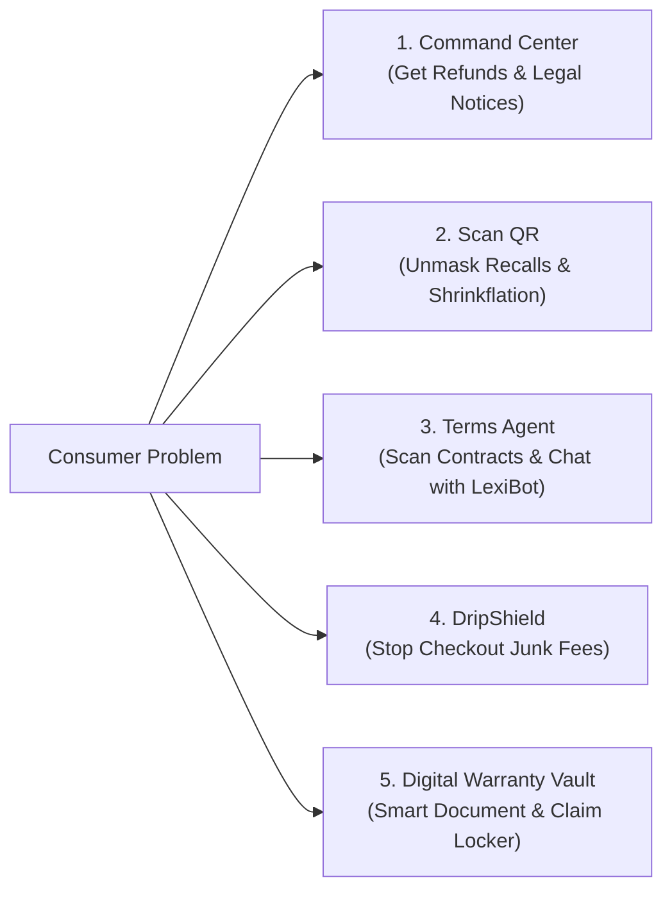

# Hackops-CR: AI-Powered Consumer Rights Platform

> A smart, simple consumer advocacy platform that protects everyday shoppers from unfair contracts, hidden fees, dangerous products, and denied warranties.

---

## What is Hackops-CR?

When you shop online or buy products today, the odds are stacked against you:
- **Sneaky Fees:** The price you see on the product page jumps at checkout with mystery "service fees" and pre-checked boxes.
- **Unreadable Contracts:** Terms of service are dozens of pages long, secretly taking away your right to go to court or cancel easily.
- **Data Blind Spots:** Product boxes hide critical safety recalls, stealth size cuts (shrinkflation), and cheap ingredient swaps.
- **Denied Refunds:** When a product breaks, customer support gives you the runaround hoping you'll give up.

**Hackops-CR** levels the playing field with five powerful, easy-to-use tools.

---

---

## The 5 Core Features

### 1. Autonomous Command Center
**Tell us what went wrong. We do the rest.**

* **How it works:** Simply type or speak your problem in plain words (e.g., *"I bought a TV 4 months ago, the screen went black, and the store refuses to fix it"*), and drop in a photo of your receipt or chat screenshot.
* **What it does for you:**
  1. **Reads your receipt:** Pulls out the store name, date, and amount paid automatically.
  2. **Checks the law:** Finds the exact consumer protection law that applies (like the legal warranty of merchantability).
  3. **Calculates your refund:** Adds up the purchase price plus statutory interest and repair costs.
  4. **Writes a Formal 15-Day Demand Letter:** Generates a professional legal notice ready to email or print and send to the company's legal department.
  5. **15-Day Countdown Tracker:** Tracks the company's deadline to pay you back, and prepares small claims paperwork if they ignore you.

---

### 2. "Scan QR" — Product History & Blind Spot Engine
**Scan any barcode to see what the box isn't telling you.**

* **How it works:** Point your phone camera at any product barcode or QR code in a store or at home.
* **What it shows you instantly:**
  * 🚨 **Safety Recalls:** Checks official government safety databases (CPSC and FDA) to warn you if the product has a fire hazard, choking risk, or bacterial contamination.
  * 📉 **Shrinkflation Alert:** Tells you if the brand reduced the package size (e.g., down from 500g to 420g) while charging the same price.
  * 🏭 **True Brand Owner:** Shows which mega-conglomerate or white-label factory actually makes the product, unmasking "independent" marketing claims.
  * 🔧 **Repairability Score:** Rates how easy the product is to open and fix on a 1-to-10 scale (based on official Right to Repair standards).

---

### 3. Terms & Conditions Agent & LexiBot
**Never read a 50-page legal contract again.**

* **How it works:** Paste a link to any company's Terms of Service or upload the PDF.
* **What it does for you:**
  * 📊 **A to F Fairness Grade:** Instantly grades the agreement so you know if it's fair or predatory.
  * 🎯 **5-Axis Risk Radar:** Shows visual scores across 5 simple areas:
    1. *Dispute Rights:* Can you go to court, or are you forced into private arbitration?
    2. *Account Safety:* Can they delete your account and keep your money?
    3. *Fair Liability:* Does the company take responsibility if they mess up?
    4. *Data Privacy:* Do they sell your personal data to advertisers?
    5. *Transparency:* Can they change the rules without telling you?
  * 💬 **Chat with LexiBot:** Ask questions in plain English (*"Can I cancel anytime?"*, *"Will they auto-charge my credit card?"*), and get direct answers backed by the exact sentence from the contract.

---

### 4. "DripShield" — Checkout Price & Fee Auditor
**Stop hidden fees before you pay.**

* **How it works:** Monitors online shopping checkout pages in real time as you move from the product listing to payment.
* **What it does for you:**
  * 🔍 **Price Drift Tracker:** Flags when the final price increases over the advertised sticker price.
  * 🚨 **Junk Fee Detector:** Identifies unlawful fees under Federal Trade Commission (FTC) rules, such as fake "handling" charges, "platform fees", and disguised taxes.
  * ⚡ **1-Click "De-Drip" Button:** Automatically unchecks sneaky pre-selected boxes (like extra shipping insurance or optional donations) and restores the lowest honest price.
  * 📝 **FTC Complaint Ready:** Saves timestamped proof of price tricks so you can report dishonest merchants with one click.

---

### 5. Digital Warranty Vault
**FEATURE 5  : Digital Warranty Vault: A smart, AI-powered digital locker that allows consumers to securely store and manage all their product-related documents, including purchase invoices, warranty cards, bills, QR codes, serial numbers, extended warranty certificates and repair receipts, eliminating the risk of losing physical warranty cards or forgetting important details. Users can simply scan a QR code, upload a photograph or PDF, or capture a bill using their camera, and the system automatically extracts important information such as product name, brand, model number, serial number, purchase date, seller details and warranty duration using OCR and AI. It automatically calculates warranty expiry dates and sends timely reminders before the warranty expires. Each purchased product gets its own digital product profile containing its complete purchase history, warranty details and repair records. When a product develops a problem, users can access their stored documents, check warranty conditions, understand potential claim eligibility, identify the manufacturer's authorised service channels and generate a warranty claim request with the necessary supporting documents. It can also support extended warranty tracking, family-wide product management and service history, creating a centralised digital ownership record that protects consumers throughout the entire lifecycle of their purchased products.**

* **Key Highlights:**
  * 📂 **Centralised Document Vault:** Securely store and manage purchase invoices, warranty cards, bills, QR codes, serial numbers, extended warranty certificates, and repair receipts—eliminating lost paperwork.
  * 📸 **AI & OCR Extraction:** Scan a QR code, upload a photo/PDF, or capture a receipt with your camera; the system extracts product name, brand, model, serial number, purchase date, seller details, and warranty duration automatically.
  * ⏳ **Smart Expiry Tracking & Alerts:** Auto-calculates expiration dates and sends timely notifications before warranty coverage ends.
  * 🗂️ **Digital Product Profiles:** Creates a dedicated lifecycle profile for each product, recording purchase history, warranty terms, and repair records.
  * 🛠️ **Seamless Warranty Claims:** Instantly inspect stored documents, verify warranty terms, assess claim eligibility, find manufacturer-authorised service centers, and generate complete claim requests.
  * 👨‍👩‍👧‍👦 **Extended Warranty & Family Sharing:** Tracks extended warranties, family-wide product inventories, and full service histories for complete lifecycle protection.

---

## How the Tech Works (In Plain English)

* **Runs in Your Browser:** Fast, private, and free. Your receipts and contracts are processed right on your device, not sold or sent to paid cloud APIs.
* **Zero Guesswork:** The legal engine uses set statutory rules, so it never invents fake laws or imaginary numbers.
* **Real Public APIs:** Connects to official open data sources like the U.S. Consumer Product Safety Commission (CPSC), the FDA, Open Food Facts, and Right to Repair indexes.

---

## Research Papers & Sources

This platform is built on real academic studies and legal frameworks:

| Feature | Academic Paper / Legal Rule | Key Finding | Link |
|---|---|---|---|
| **Command Center** | *The Squeaky Wheel System* (Schmitz, Pepperdine Law Review) | Proves companies only refund aggressive complainers; automated legal notices give everyone equal power. | [Read Paper](https://digitalcommons.pepperdine.edu/plr/vol39/iss2/2/) |
| **Command Center** | *Mass Arbitration & Fee Inversion* (Glover, Stanford Law Review) | Shows that mandatory arbitration costs companies \$3,400+ per case, giving consumers huge leverage to get refunds. | [Read Paper](https://www.stanfordlawreview.org/print/article/mass-arbitration/) |
| **Scan QR** | *The Market for Lemons* (Akerlof, Nobel Laureate) | Explains how hidden product flaws hurt consumers; instant barcode scanning eliminates this secrecy. | [Read Paper](https://doi.org/10.2307/1879431) |
| **Scan QR** | *Digital Product Passports* (EU ESPR Standard) | Global framework for tracking product history, repairability, and safety data via 2D barcodes. | [EUR-Lex](https://eur-lex.europa.eu/eli/reg/2024/1781/oj) |
| **Terms Agent** | *Project CLAUDETTE* (Lippi et al., AI & Law) | Created the standard AI model for detecting 9 types of unfair contract clauses. | [Read Paper](https://doi.org/10.1007/s10506-019-09243-2) |
| **Terms Agent** | *The Cost of Reading Privacy Policies* (McDonald & Cranor) | Showed it takes 244 hours a year to read privacy policies; AI readers are necessary. | [Read Paper](https://kb.osu.edu/handle/1811/72839) |
| **Terms Agent** | *Appoint LLM Readers* (Pałka et al., AI & Law 2025) | Demonstrates that AI assistants should read contracts for consumers instead of humans doing it. | [Read Paper](https://doi.org/10.1007/s10506-025-09442-0) |
| **DripShield** | *FTC Deceptive Fee Rule* (16 CFR Part 464) | New federal trade rule making hidden drip pricing and surprise checkout fees illegal. | [FTC Rule](https://www.ftc.gov) |
| **DripShield** | *Consumer Reactions to Drip Pricing* (Santana et al., JMR) | Proves how surprise fees exploit people's reluctance to start shopping over again. | [Read Paper](https://doi.org/10.1177/0022243720914440) |
