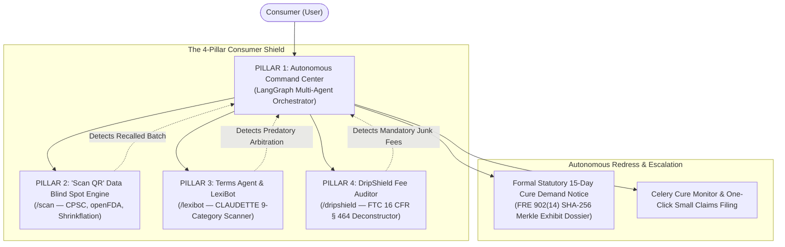

# Hackops-CR: AI-Powered Consumer Rights Platform

> **Modern Warm-Minimalist + Bento Grid + Glassmorphic Editorial Architecture**  
> An autonomous, full-stack consumer advocacy system designed to protect everyday shoppers from unfair adhesion contracts, hidden checkout fees, hazardous products, and denied warranty claims.

---

## 1. System File Structure

The project is structured as a decoupled, production-grade monorepo combining a high-performance **Next.js 15 App Router** frontend with a **FastAPI + LangGraph** multi-agent backend:

```text
consumer-rights-platform/
├── frontend/                     # Next.js 15 App Router (React 19, Tailwind CSS)
│   ├── app/
│   │   ├── page.tsx              # Landing Page (EvolveAI style + Bento Grid)
│   │   ├── layout.tsx            # Root layout with warm-minimalist glass theme
│   │   ├── command-center/       # Feature 1: Stockroom-style Operations & Notice Generator
│   │   │   └── page.tsx
│   │   ├── scan/                 # Feature 2: Barcode & Recall Camera Scanner
│   │   │   └── page.tsx
│   │   ├── lexibot/              # Feature 3: T&C Analyzer & Grounded Chatbot
│   │   │   └── page.tsx
│   │   ├── dripshield/           # Feature 9: FTC Part 464 Drip Price Audit
│   │   │   └── page.tsx
│   │   ├── research/             # Academic corpus & statutory bibliography
│   │   │   └── page.tsx
│   │   └── api/                  # Next.js Edge proxy routes (streaming SSE to backend)
│   ├── components/
│   │   ├── visualizers/          # Pure SVG / Recharts components
│   │   │   ├── RiskRadar.tsx     # 5-Axis CLAUDETTE Contract Risk Radar
│   │   │   └── FeeWaterfall.tsx  # FTC Part 464 Price Drift Waterfall
│   │   ├── scanner/              # ZXing WebRTC camera scanner & GS1 parser
│   │   │   └── BarcodeCamera.tsx
│   │   ├── pdf/                  # @react-pdf/renderer dynamic court docket templates
│   │   │   └── StatutoryNoticePDF.tsx
│   │   ├── layout/               # Cruip Mosaic sleek sidebar & header components
│   │   │   ├── Sidebar.tsx
│   │   │   └── Header.tsx
│   │   └── ui/                   # Warm-minimalist glass cards, buttons, badges
│   └── lib/                      # Client utilities, WebCrypto hashing & SSE hooks
│       ├── api-client.ts
│       └── merkle.ts
│
└── backend/                      # FastAPI Python Service (Python 3.12+)
    ├── app/
    │   ├── main.py               # FastAPI application entrypoint & middleware
    │   ├── api/                  # REST API route routers
    │   │   ├── cases.py          # Claim management & status endpoints
    │   │   ├── scan.py           # Barcode resolution & recall queries
    │   │   ├── contracts.py      # Terms of service analysis endpoints
    │   │   └── drip.py           # Checkout fee audit endpoints
    │   ├── agents/               # LangGraph Multi-Agent Workflows
    │   │   ├── state.py          # Central case state definition (GrievanceState)
    │   │   ├── orchestrator.py   # Main LangGraph graph coordinator
    │   │   ├── issue_spotter.py  # UCC § 2-314 & ROSCA statutory reasoning agent
    │   │   ├── evidence_ocr.py   # Docling / PDF.js multimodal receipt parser
    │   │   ├── damage_calc.py    # 10% statutory pre-judgment interest calculator
    │   │   └── notice_drafter.py # Self-authenticating legal demand letter synthesizer
    │   ├── nlp/                  # Legal NLP models & heuristics
    │   │   ├── claudette.py      # CLAUDETTE 9-category contract classifier
    │   │   └── rag.py            # Sentence-chunked grounded RAG for LexiBot
    │   ├── integrations/         # Regulatory & open data API clients
    │   │   ├── cpsc.py           # CPSC SaferProducts REST client
    │   │   ├── fda.py            # openFDA Enforcement API client
    │   │   ├── openfoodfacts.py  # Open Food & Products Facts v3 client
    │   │   └── ifixit.py         # French Repairability Index & iFixit client
    │   └── tasks/                # Celery / Redis asynchronous worker tasks
    │       ├── celery_app.py
    │       └── cure_monitor.py   # Living 15-day cure window countdown state machine
    ├── pyproject.toml
    └── Dockerfile
```

---

## 2. Design Language & UI Specifications

The interface unifies three design references into a **Modern Warm-Minimalist + Bento Grid + Glassmorphic Editorial** aesthetic:

| Surface Component | Reference Inspiration | Visual & Functional Execution |
|---|---|---|
| **Landing Page** | `https://evolveai.chitkara.edu.in/` | Bold mission-driven editorial typography, floating badge pills, live stats counter (`$1,820+ Recovered`), dynamic bento grid showcase, and dark warm obsidian background. |
| **Command Center** | `https://uicookies.com/demo/#stockroom` | Operational dispatch dashboard, case ledger table, quick status ribbons (*Active Window*, *Draft*, *Refunded*), 60-second claim wizard, and 15-day cure countdown clock. |
| **Feature Panels** | `https://cruip.com/demos/mosaic/` | Sleek dark sidebar with icon glow badges, metric sparkline cards, 5-axis SVG Risk Radar, interactive grounded chatbot (LexiBot), and 1-click "De-Drip" sanitizer. |

### Color Palette & Styling Tokens
* **Base Canvas:** Deep warm obsidian (`#0c0a09` / `stone-950`).
* **Card Surfaces:** Frosted dark stone (`#1c1917` / `stone-900`) with glassmorphism (`backdrop-blur-md bg-stone-900/80`).
* **Borders & Accents:** Subtle rim borders (`border-stone-800/80`), warm amber/terracotta highlights (`#f59e0b` / `#d97706`), deep indigo badges (`#6366f1`), and emerald green recovery indicators (`#10b981`).
* **Typography:** Inter / Plus Jakarta Sans for editorial titles, paired with JetBrains Mono for statutory citations, currency amounts, dates, and SHA-256 Merkle hashes.

---

## 3. Four Core Pillars: Architecture & Engineering



---

### PILLAR 1: Autonomous Consumer Command Center (`/app/command-center/`)
* **Core Function:** Natural language grievance intake, multi-agent goal delegation, legal issue spotting, and self-authenticating 15-day demand notice generation.
* **UI Design (`uiCookies Stockroom` style):**
  * **Operational Metric Ribbon:** Total claims value with 10% statutory pre-judgment interest (`$1,820.13`), active notices (`2 Pending`), corporate AAA arbitration liability exposure (`$10,200.00`), and a `94.2%` pre-litigation settlement rate.
  * **Stockroom Case Ledger:** Table tracking Case ID & Merkle Hash, Merchant & Corporate Registered Agent, Defect Category, Statutory Cause, and 15-Day Cure Status.
  * **Interactive Wizard:** Presets for real-world claims (*Smart TV display burnout*, *Illegal recurring subscription cancellation fees*, *Appliance motor seizure*).
* **Backend Architecture (`backend/app/agents/`):**
  * `state.py`: Central `GrievanceState` (TypedDict) capturing factual predicates without LLM hallucination.
  * `evidence_ocr.py`: Docling / PDF.js pipeline parsing receipts, extracting merchant, date, amount, and refusal transcripts with an arithmetic balance cross-check:
    $$|\text{Subtotal} + \text{Tax} + \text{Shipping} - \text{Total}| < 0.02$$
  * `issue_spotter.py`: Forward-chaining rule engine evaluating **UCC § 2-314** (Implied Warranty of Merchantability), **ROSCA (15 U.S.C. § 8403)**, and **State UDAP/CLRA laws**. Disclaimers are invalidated under the Magnuson-Moss Warranty Act (15 U.S.C. § 2308).
  * `damage_calc.py`: Computes base purchase price + 10% statutory pre-judgment interest ($I = P \times \frac{0.10}{365} \times \Delta t$) + $18.50 mailing incidentals.
  * `notice_drafter.py`: Formulates an authoritative **Statutory Pre-Dispute Demand Letter** imposing a 15-day cure window. Highlights the **AAA Arbitration Fee Inversion Leverage** (warning merchant of \$3,400+ in mandatory corporate filing fees) and appends a **FRE 902(14) SHA-256 Merkle root** with a 28 U.S.C. § 1746 declaration.
  * `tasks/cure_monitor.py`: Celery task executing the 15-day countdown state machine (Day 0: Notice dispatched $\rightarrow$ Day 7: Courtesy nudge $\rightarrow$ Day 14: Final warning $\rightarrow$ Day 16: Unseals pre-filled Small Claims Court paperwork).

---

### PILLAR 2: "Scan QR" — Product History & Blind Spot Engine (`/app/scan/`)
* **Core Function:** Point-of-sale barcode scanner unmasking active safety recalls, stealth package downsizing (*shrinkflation*), true corporate parentage, and repairability scores.
* **UI Design (`Cruip Mosaic` style):**
  * **Hardware-Accelerated Scanner (`components/scanner/BarcodeCamera.tsx`):** W3C native `BarcodeDetector` (60fps GPU loop) with ZXing WebRTC fallback.
  * **GS1 Digital Link URI Parser:** Extracts `/01/{GTIN}/10/{LOT}/21/{SERIAL}` to trace specific contaminated batches.
  * **Consumer Safety & Transparency Scorecard (0–100):** Visual letter grade badge (A to F) with sub-scores for Safety (30%), Purity (25%), Value Integrity (15%), Repairability (15%), and Corporate Ownership (15%).
* **Backend Integrations (`backend/app/integrations/`):**
  * `cpsc.py`: Queries the CPSC Recall REST API (`saferproducts.gov`) by UPC and model.
  * `fda.py`: Queries the openFDA Enforcement API for food, cosmetic, and pharma recalls (Class I, II, III).
  * `openfoodfacts.py`: Queries Open Food Facts v3 to detect **Shrinkflation** ($\Delta W \ge 3.0\%$ with constant price) and **Skimpflation** (Rank-Biased Overlap on ingredient degradation).
  * `ifixit.py`: Queries the French Repairability Index (`indicereparabilite` via `data.gouv.fr`) for official 0–10 electronics repair scores.

---

### PILLAR 3: Terms & Conditions Agent & Interactive LexiBot (`/app/lexibot/`)
* **Core Function:** Client-side legal contract auditor evaluating standard-form adhesion agreements across the 9 CLAUDETTE categories, accompanied by an appointed AI legal guardian chatbot.
* **UI Design (`Cruip Mosaic` style):**
  * **5-Axis SVG Risk Radar (`components/visualizers/RiskRadar.tsx`):** Pure React/SVG radar chart projecting *Dispute Autonomy*, *Account Security*, *Liability Balance*, *Data Sovereignty*, and *Contract Transparency*.
  * **CLAUDETTE Flagged Clauses Drawer:** Lists predatory clauses with severity badges and legal explanations.
  * **Interactive LexiBot Chat Window:** Conversational assistant testing consumer hypotheses (*"Can I cancel anytime?"*, *"Will they auto-renew?"*) with strict NLI grounding.
* **Backend NLP Engine (`backend/app/nlp/`):**
  * `claudette.py`: Classifies sentences across the 9 canonical unfair terms (unilateral changes, arbitration waivers, liability caps) using sub-linear saturation scoring:
    $$\text{Penalty}_c = w_c \cdot \min(100, 30 \cdot \ln(1 + n_c))$$
  * `rag.py`: Segments documents into immutable sentence IDs (`[S-001]`). Employs hybrid retrieval (dense vectors + BM25). A verification guard ensures every bot assertion terminates with a verified verbatim citation `[Clause X.X: "..."]`.

---

### PILLAR 4: "DripShield" — Checkout Price & Fee Auditor (`/app/dripshield/`)
* **Core Function:** Real-time checkout price drift auditor detecting sequential fee escalation, unmasking unlawful charges under FTC 16 CFR Part 464, and providing a 1-click sanitizer.
* **UI Design (`Cruip Mosaic` style):**
  * **Funnel Price Drift Timeline:** Step-by-step interactive progression (*Product Page $49.00* $\to$ *Cart $57.50* $\to$ *Shipping $65.70* $\to$ *Payment $72.49*).
  * **Fee Waterfall Deconstruction (`components/visualizers/FeeWaterfall.tsx`):** Itemized breakdown distinguishing valid taxes from illegal junk fees.
  * **⚡ 1-Click "De-Drip" Sanitizer:** Strips illegal fees, unchecks pre-selected add-ons, and drops the total to the honest minimum ($57.80).
  * **Export FTC Dossier Button:** Packages timestamped DOM pricing evidence into a regulatory complaint packet.
* **Backend Audit Engine (`backend/app/api/drip.py`):**
  * Maps charges against the **FTC Trade Regulation Rule on Unfair or Deceptive Fees (16 CFR Part 464)**:
    * Mandatory platform/convenience fees (§ 464.2(a))
    * Disguised regulatory surcharges (§ 464.3(b))
    * Hidden handling markups (§ 464.3(a))
    * Pre-checked negative option add-ons (ROSCA 15 U.S.C. § 8403)

---

## 4. Academic Research Foundation & Citation Matrix

| Feature | Academic Paper / Legal Rule | Author / Venue | Key Finding & Operationalization | Link |
|---|---|---|---|---|
| **Command Center** | *Access to Consumer Remedies in the Squeaky Wheel System* | Amy J. Schmitz (*Pepperdine Law Review*) | Proves companies systematically settle only with aggressive consumers; automated statutory notices equalize power. | [Paper](https://digitalcommons.pepperdine.edu/plr/vol39/iss2/2/) |
| **Command Center** | *Mass Arbitration & Fee Inversion* | J. Maria Glover (*Stanford Law Review*) | Mandatory arbitration costs companies \$3,400+ per case; weaponizes fee liability to compel refunds. | [Paper](https://www.stanfordlawreview.org/print/article/mass-arbitration/) |
| **Command Center** | *The Fourth Party in Algorithmic Dispute Resolution* | Wing, Martinez, Katsh, & Rule (*Negotiation Journal*) | Establishes autonomous computational agents as a "Fourth Party" that diagnoses claims and structures redress. | [DOI](https://doi.org/10.1111/nejo.12350) |
| **Scan QR** | *The Market for "Lemons": Quality Uncertainty* | George A. Akerlof (*Quarterly Journal of Economics*) | Information asymmetry leads to adverse selection; instant barcode scanning collapses consumer search costs. | [DOI](https://doi.org/10.2307/1879431) |
| **Scan QR** | *Digital Product Passports for a Circular Economy (ESPR)* | European Union (*Regulation EU 2024/1781*) | Global standard for tracking product history, repairability, and instantaneous hazardous recall alerts via 2D barcodes. | [EUR-Lex](https://eur-lex.europa.eu/eli/reg/2024/1781/oj) |
| **Terms Agent** | *Project CLAUDETTE: Automated Unfair Clause Detection* | Lippi et al. (*Artificial Intelligence and Law*) | Benchmark machine learning taxonomy for classifying 9 categories of unfair terms in consumer contracts. | [DOI](https://doi.org/10.1007/s10506-019-09243-2) |
| **Terms Agent** | *The Cost of Reading Privacy Policies* | McDonald & Cranor (*I/S: Journal of Law and Policy*) | Quantified that reading policies takes 244 hours per year (\$365B economic friction); AI readers are essential. | [Paper](https://kb.osu.edu/handle/1811/72839) |
| **Terms Agent** | *Make Privacy Policies Longer and Appoint LLM Readers* | Pałka et al. (*Artificial Intelligence and Law 2025*) | Proves consumers should appoint dedicated AI reader agents to safeguard their rights rather than reading agreements. | [DOI](https://doi.org/10.1007/s10506-025-09442-0) |
| **DripShield** | *FTC Trade Regulation Rule on Deceptive Fees* | Federal Trade Commission (*16 CFR Part 464*) | Codified federal rule establishing strict liability for hidden drip pricing and surprise checkout fees. | [FTC Rule](https://www.ftc.gov) |
| **DripShield** | *Consumer Reactions to Drip Pricing* | Santana, Dallas, & Morwitz (*Journal of Marketing Research*) | Proves sequential checkout fees exploit consumer behavioral sunk costs and initial price anchoring. | [DOI](https://doi.org/10.1177/0022243720914440) |
