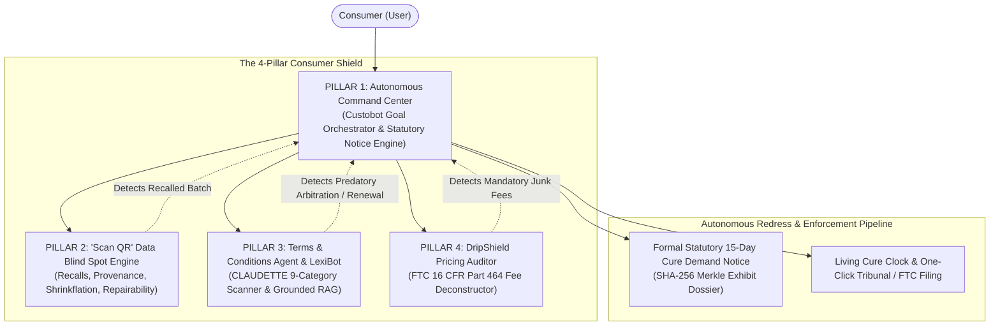

# Hackops-CR: AI-Powered Consumer Rights & Awareness Platform
> **Focused 4-Pillar Architecture: Concrete Implementable Specifications & Academic Foundations**

---

## 1. Executive Summary: The Focused 4-Pillar Defense Suite

**Hackops-CR** is streamlined around four complementary, high-impact pillars that safeguard consumers across the entire purchasing and redress lifecycle:



1. **Pillar 1: The Autonomous Consumer Command Center ("Custobot Orchestrator")** — End-to-end task automation: the user states their grievance in natural language, and autonomous workers extract evidence via client-side OCR, calculate statutory damages, and generate an authoritative 15-day cure demand notice with cryptographic SHA-256 evidence hashing.
2. **Pillar 2: "Scan QR" — Product History, Recalls & Data Blind Spot Engine** — In-browser camera scanning linking GS1 barcodes to live CPSC/openFDA recall APIs, historical shrinkflation/skimpflation telemetry, corporate parentage unmasking, and Right to Repair scoring.
3. **Pillar 3: Terms and Conditions Agent & Interactive Chatbot ("LexiBot")** — Fast client-side contract analysis across the 9 CLAUDETTE categories, 5-axis SVG Risk Radar, and a grounded conversational chatbot with strict sentence-level citations.
4. **Pillar 4: "DripShield" — Algorithmic Drip Pricing & Fee Escalation Auditor** — Real-time tracking of checkout price drift, deconstructing hidden junk fees under FTC 16 CFR Part 464 and providing a 1-click "De-Drip" sanitizer.

---

## 2. In-Depth Technical & Practical Implementation Specifications

---

### PILLAR 1: The Autonomous Consumer Command Center ("Custobot Orchestrator")
*A zero-hallucination legal proxy that ingests unstructured grievance details, triages claims through deterministic statutory trees, and generates self-authenticating legal demand letters.*

```
                 User: "I bought a smart TV 5 months ago; screen motherboard died;
                        store refuses warranty claiming 'wear & tear'.
                        Here is my receipt. Get my refund."
                                      │
                                      ▼
┌────────────────────────────────────────────────────────────────────────┐
│                   AUTONOMOUS CONSUMER COMMAND CENTER                   │
├────────────────────────────────────────────────────────────────────────┤
│  1. Hybrid Client-Side Ingestion: PDF.js vector text + Tesseract.js    │
│  2. Neuro-Symbolic Decoupling: Fact Extraction only -> Rule Engine     │
│  3. Deterministic Decision Tree: UCC § 2-314 Implied Warranty of Good  │
│  4. Damage Engine: Base $649 + Statutory Prejudgment Interest (10%)    │
│  5. Self-Authenticating Notice: FRE 902(14) SHA-256 Merkle Root       │
│  6. Economic Leverage: AAA Arbitration Fee Inversion ($3,400 liability)│
└────────────────────────────────────────────────────────────────────────┘
                                      │
                                      ▼
           [ Executed Action Bundle: Download Notice / One-Click File ]
```

#### A. Neuro-Symbolic Decoupling Principle (Zero Hallucination)
To eliminate probabilistic LLM errors, the Command Center strictly decouples fact extraction from legal reasoning:
1. **Neural Component (Fact Extraction Only):** An LLM constrained by strict JSON Schema grammar decoding (Outlines / OpenAI Structured Outputs) extracts *only* factual predicates (merchant, purchase date, failure date, amount paid, refusal statement) from the input text and OCR tokens.
2. **Symbolic Component (Deterministic Forward-Chaining Rule Engine):** Code evaluates the extracted facts against codified statutes:
   * **UCC § 2-314 (Implied Warranty of Merchantability):** Checks if transaction is a sale of goods, seller is a merchant, defect arose under ordinary domestic use, and notice is timely under UCC § 2-607(3)(a). Disclaimers are invalidated if a written warranty was given under the Magnuson-Moss Warranty Act (15 U.S.C. § 2308).
   * **ROSCA (15 U.S.C. § 8403) & FTC Negative Option Rule (16 CFR Part 425):** Flags per se unlawful cancellation friction if online signups require phone calls to cancel.
   * **State Consumer Protection Acts (e.g., California CLRA § 1770(a)(14)):** Flags deceptive representations that store policies override statutory warranties.

#### B. Zero-Cost Client-Side OCR & Layout Ingestion Engine
* **Tier 1 (Native Vector PDF Extraction):** `pdfjs-dist` extracts text strings and bounding boxes from digital receipts (Amazon, Apple, Stripe) in <25ms with 100% precision and zero compute overhead.
* **Tier 2 (Client-Side Wasm OCR):** `tesseract.js` running in a Web Worker for photos and crumpled paper receipts, preprocessed via HTML5 Canvas with Otsu’s adaptive binarization to eliminate shadows.
* **Arithmetic Balance Cross-Verification:**
  $$|\text{Parsed Subtotal} + \text{Parsed Tax} + \text{Parsed Shipping} - \text{Parsed Total}| < 0.02$$
  Verifies that individual OCR item amounts mathematically equal the grand total, preventing misread decimal errors.

#### C. Formal Statutory Notice & FRE 902(14) Cryptographic Evidence Hashing
* **The Strategic Fee Inversion Leverage:** Mandatory corporate arbitration clauses usually favor companies, but in individual low-dollar disputes, they create overwhelming leverage *for the consumer*. Under the American Arbitration Association (AAA) Consumer Rules, the consumer pays a nominal \$225, while the corporate defendant is assessed **\$3,400+ in mandatory, non-waivable case management and arbitrator compensation fees**. Highlighting this liability in Section 4 of the demand letter informs corporate legal teams that contesting a \$649 refund will cost them at least \$4,049, compelling prompt settlement.
* **Cryptographic Self-Authentication (FRE 902(14)):** The browser computes client-side SHA-256 digests (`crypto.subtle.digest`) for each attached invoice and chat screenshot, compiling an unassailable Merkle Tree root. The notice includes an unsworn declaration under penalty of perjury (**28 U.S.C. § 1746**), converting the demand into a court-ready evidentiary docket.
* **Living 15-Day Cure Clock & Escalation State Machine:** Tracks the statutory countdown (Day 0: Notice served $\rightarrow$ Day 7: Courtesy nudge $\rightarrow$ Day 14: 24h warning $\rightarrow$ Day 16: Unseals pre-filled Small Claims Court forms and AAA Arbitration dockets).

---

### PILLAR 2: "Scan QR" — Product History, Recalls & Data Blind Spot Engine
*Collapses consumer information acquisition costs to zero by linking physical 2D packaging codes to real-time open regulatory registries and product history.*

```
[ Packaging QR / Barcode ]
           │
           ▼
┌────────────────────────────────────────────────────────────────────────┐
│                   "SCAN QR" DATA BLIND SPOT ENGINE                     │
├────────────────────────────────────────────────────────────────────────┤
│  1. Safety & Recalls: Real-time query to CPSC / openFDA APIs           │
│  2. Corporate Provenance: Unmasks white-labeling & parent conglomerate │
│  3. Shrinkflation Radar: Historical net-weight vs. unit price shifts   │
│  4. Repairability Index: 1-10 modularity, parts availability & lockouts│
└────────────────────────────────────────────────────────────────────────┘
```

#### A. Verified Open Real-World APIs & Registries
* **CPSC Recall API (`saferproducts.gov/RestWebServices/Recall`):** Zero-auth public REST endpoint querying product recalls by UPC, brand name, and model number.
* **openFDA Enforcement API (`api.fda.gov/food/enforcement.json` & `drug/enforcement.json`):** Queries food, cosmetic, and pharmaceutical recalls, extracting hazard classification (Class I: fatal/severe; Class II: reversible; Class III: technical).
* **Open Food Facts & Open Products Facts API v3 (`world.openfoodfacts.org`):** World's largest open crowdsourced product database, retrieving historical package quantities, ingredient rankings, allergens, and Nutri-Score/Eco-Score.
* **French Repairability Index (`indicereparabilite` via `data.gouv.fr`):** Standardized 0–10 score across documentation availability, disassembly ease, spare parts delivery time, parts price ratio, and software diagnostic accessibility.

#### B. "Data Blind Spot" Detection Algorithms
1. **Shrinkflation & Skimpflation Detection:**
   * *Shrinkflation Threshold:* If package net-weight drops $\Delta W \ge 3.0\%$ while price remains constant or increases, flag as confirmed shrinkflation and calculate true unit price inflation:
     $$E_{\text{inf}} = \left( \frac{P_1 / W_1}{P_0 / W_0} - 1 \right) \times 100\%$$
   * *Skimpflation Tracking:* Applies Rank-Biased Overlap (RBO) across ingredient lists (governed by 21 CFR § 101.4 descending order of predominance) to detect when expensive whole ingredients are displaced by cheap fillers (palm oil, high fructose corn syrup, maltodextrin).
2. **Brand Pedigree & Corporate Parentage Mapper:**
   * Uses GS1 Registered Company Prefix lookup and Wikidata SPARQL queries (`P127` owned by, `P749` parent organization) to unmask when seemingly competing independent brands are owned by the exact same mega-conglomerate or white-label OEM.
3. **Allergen & Toxic Chemical Sentinel:**
   * Tokenized fuzzy matching against California Proposition 65 lists (~900 carcinogens/reproductive toxins) and EU REACH Substances of Very High Concern (SVHC).

#### C. Browser-Based Dual-Engine Scanner UX
* **Hardware-Accelerated Scanning:** Uses W3C native `BarcodeDetector` API (60fps GPU frame scanning on Chromium and Safari) with fallback to `html5-qrcode` WebAssembly.
* **GS1 Digital Link URI Parsing:** Deconstructs modern 2D QR codes into standardized Application Identifiers: `/01/{GTIN}/10/{LOT}/21/{SERIAL}` to match recalls to specific contaminated production batches.
* **Consumer Safety & Transparency Scorecard:** Synthesizes results into a clear 0–100 score across 5 weighted dimensions (Safety 30%, Purity 25%, Value Integrity 15%, Repairability 15%, Corporate Ownership 15%).

---

### PILLAR 3: Terms and Conditions Agent & Interactive Chatbot ("LexiBot")
*A dedicated legal contract guardian that ingests adhesion contracts, flags unfair terms across 9 categories, scores fairness, and answers user questions with verified sentence citations.*

```
[ Terms of Service / Privacy Policy PDF / URL ]
                        │
                        ▼
┌────────────────────────────────────────────────────────────────────────┐
│                   TERMS & CONDITIONS AGENT ("LEXIBOT")                 │
├────────────────────────────────────────────────────────────────────────┤
│  • CLAUDETTE 9-Category Scanner (Arbitration, Liability, Unilateral)   │
│  • 0-100 Consumer Fairness Grade & 5-Axis SVG Risk Radar Chart         │
│  • Interactive Grounded Chatbot: Ask natural language questions        │
│    (Answers strictly backed by verbatim clause citations & analysis)   │
└────────────────────────────────────────────────────────────────────────┘
```

#### A. Three-Tier Client-Side NLP Architecture (Zero Cloud Cost)
* **Tier 0 (Deterministic Regex Sieve, <5ms):** High-recall regex patterns filter out 75–80% of boilerplate paragraphs (definitions, recitals), preserving browser CPU.
* **Tier 1 (In-Browser Transformers.js / ONNX Runtime Web, ~120ms):** Runs `@huggingface/transformers` in client WebAssembly/WebGPU. Evaluates candidate sentences against pre-computed vector centroids from the CLAUDETTE corpus using cosine similarity ($\text{Sim} \ge 0.72$).
* **Tier 2 (In-Browser SLM via WebGPU, ~400ms):** Uses `@mlc-ai/web-llm` running `Llama-3.2-1B-Instruct` or `Qwen2.5-1.5B-Instruct` directly in browser VRAM for grounded conversational reasoning.

#### B. CLAUDETTE 9-Category Classifier & Sub-Linear Scoring
* Grounded in **Lippi et al. (Artificial Intelligence and Law 2019)** and **Chalkidis et al. (*LexGLUE*, ACL 2022)**, classifying clauses across 9 categories:
  * `C1`: Unilateral change of terms (weight 0.85)
  * `C2`: Unilateral change of service (weight 0.80)
  * `C3`: Unilateral termination / suspension (weight 0.90)
  * `C4`: Limitation of liability (weight 0.95)
  * `C5`: Arbitration & class-action waiver (weight 1.00)
  * `C6`: Mandatory foreign jurisdiction (weight 0.75)
  * `C7`: Excessive intellectual property licensing (weight 0.70)
  * `C8`: Browse-wrap contract formation (weight 0.80)
  * `C9`: Unilateral consumer indemnification (weight 0.90)
* **Sub-Linear Saturation Formula:** Prevents multiple clauses in one category from skewing the composite grade:
  $$\text{Penalty}_c = w_c \cdot \min\left(100, 30 \cdot \ln(1 + n_c)\right)$$
* **Composite Fairness Score ($\mathcal{F} \in [0, 100]$):** Maps into intuitive letter grades (A: $\ge 90$, B: 80–89, C: 70–79, D: 60–69, F: $<60$).

#### C. 5-Axis Pure SVG Risk Radar Chart
* Aggregates the 9 categories into 5 human-interpretable dimensions: *Dispute Autonomy, Account Security, Liability Balance, Data Sovereignty, and Contract Transparency*.
* Renders smoothly in pure React/SVG geometry with concentric dashed reference webs and interactive vertex nodes.

#### D. Interactive "LexiBot" with Strict Grounded RAG
* **Deterministic Sentence Chunking:** Documents are segmented into immutable, numbered sentence IDs (`[S-001]`, `[S-002]`).
* **Hybrid Retrieval:** Dense sentence vectors + BM25 keyword matching retrieve the top 5 relevant clauses.
* **Strict NLI Grounding (ContractNLI):** Every response assertion must conclude with an exact sentence citation `[S-xxx]`. A client-side AST guard intercepts the output; if any claim lacks a verbatim citation, it replaces the speculative text with the raw verified clause.
* **Privacy & Rights Nutrition Label:** Modeled on the FDA Nutrition Label, presenting high-contrast pass/fail badges for critical terms.

---

### PILLAR 4: "DripShield" — Algorithmic Drip Pricing & Fee Escalation Auditor
*Audits checkout funnels in real time, detecting sequential fee escalation, unmasking bogus surcharges under FTC 16 CFR Part 464, and providing a 1-click sanitizer.*

```
Listing Page ($49.00) ──> Cart ($57.50) ──> Payment Step ($66.19)
                                                  │
                                                  ▼
┌────────────────────────────────────────────────────────────────────────┐
│                     DRIPSHIELD CHECKOUT AUDITOR                        │
├────────────────────────────────────────────────────────────────────────┤
│  • Price Drift: +$17.19 (+35.1% over advertised listing price)         │
│  • 🚨 Mandatory Platform Fee: +$8.50 (Junk Fee under FTC § 464.2(a))   │
│  • 🚨 "Regulatory Mandate" Fee: +$3.20 (Deceptive under § 464.3(b))    │
│  • 🚨 Pre-Checked Delivery Insurance: +$2.99 (Negative Option Trap)    │
│  • 📦 Carrier Postage: +$5.00 / 🏛️ State Sales Tax: +$3.80 (Valid)     │
├────────────────────────────────────────────────────────────────────────┤
│  [ ⚡ 1-Click "De-Drip" (Strips Junk Fees) ]  [ 📋 Export FTC Dossier ] │
└────────────────────────────────────────────────────────────────────────┘
```

#### A. Multi-Anchor Price Drift Detection Architecture
Drip pricing exploits consumer behavioral sunk costs (Santana et al. 2020; Blake et al. 2021):
1. **Initial Price Anchor:** Extracts base listing price from schema markup (`itemprop="price"`, JSON-LD `offers.price`).
2. **DOM Mutation Observer:** Monitors cart and checkout container mutations (`.checkout-total`, `.summary-price`).
3. **Network Sniffer (Fetch / XHR Interception):** Intercepts dynamic AJAX calls to checkout calculation endpoints (`/api/checkout/calculate`) to capture raw itemized fee breakdowns.
4. **Drift Mathematical Model:**
   $$\Delta P = P_{\text{final}} - P_{\text{listing}}, \quad \% \text{Drift} = \left(\frac{P_{\text{final}} - P_{\text{listing}}}{P_{\text{listing}}}\right) \times 100\%$$

#### B. FTC 16 CFR Part 464 Statutory Mapping & Deceptive Fee Classifier
Operationalizes the **FTC Trade Regulation Rule on Unfair or Deceptive Fees (16 CFR Part 464)**:
1. **Mandatory Platform & Convenience Fees (§ 464.2(a)):** Outlaws concealing mandatory fees until later checkout stages.
2. **Disguised Regulatory / Government Surcharges (§ 464.3(b)):** Prohibits misrepresenting internal business operating costs as government-mandated taxes.
3. **Hidden Handling / Fulfillment Markups (§ 464.3(a)):** Prohibits deceptive partitioning of postage from arbitrary "handling" charges.
4. **Pre-Checked Negative Option Add-Ons (16 CFR Part 425 & ROSCA):** Identifies pre-checked checkboxes adding recurring or optional charges without affirmative consent.

#### C. "True Cost Calculator" & 1-Click "De-Drip" Sanitizer
* **Upfront Floating Badge:** Injects the verified all-inclusive total onto product catalog listings.
* **Fee Waterfall Deconstruction Component:** Visual stacked breakdown distinguishing legitimate taxes and carrier postage from illegal junk fees.
* **1-Click "De-Drip" Action:** Client-side script unchecks pre-selected add-ons, strips unnecessary opt-in items, and recalculates the true minimum total.
* **FTC Statutory Violation Dossier:** Captures timestamped DOM pricing snapshots, auto-generating a pre-filled complaint packet for submission to the FTC and state Attorney General.

---

## 3. Academic Citation Matrix

| # | Reference & Citation | Publication Venue | Core Contribution / Methodology | Operationalized Pillar |
|---|---|---|---|---|
| 1 | **Van Loo, R. (2021).** *The Digital Marketplace and Consumer Agents.* | *Boston University Law Review*, 101, pp. 101–158. | Conceptual foundation for autonomous algorithmic consumer proxies. | **Pillar 1:** Autonomous Command Center task orchestrator. |
| 2 | **Busch, C. (2025/2026).** *Consumer Law for AI Agents: The "Custobot Economy."* | *Journal of European Consumer and Market Law*. | Delegation models and business strict liability in AI-driven commerce. | **Pillar 1:** Goal-driven autonomous grievance delegation. |
| 3 | **Schmitz, A. J. (2012).** *Access to Consumer Remedies in the Squeaky Wheel System.* | *Pepperdine Law Review*, 39(2), pp. 279–366. [Digital Commons](https://digitalcommons.pepperdine.edu/plr/vol39/iss2/2/) | Empirical proof of regressive dispute resolution favoring only aggressive claimants. | **Pillar 1:** Universal pre-litigation statutory notice generation. |
| 4 | **Wing, L., Martinez, J., Katsh, E., & Rule, C. (2021).** *Designing Ethical ODR Systems: The Rise of the Fourth Party.* | *Negotiation Journal*, 37(1), pp. 49–64. [DOI: 10.1111/nejo.12350](https://doi.org/10.1111/nejo.12350) | The Fourth Party concept in algorithmic dispute structuring and triage. | **Pillar 1:** AI Evidentiary Dossier & claim orchestrator. |
| 5 | **Glover, J. M. (2022).** *Mass Arbitration.* | *Stanford Law Review*, 74(6), pp. 1283–1383. [Stanford Law Review](https://www.stanfordlawreview.org/print/article/mass-arbitration/) | Mandatory arbitration fees invert corporate leverage in consumer disputes. | **Pillar 1:** Corporate arbitration fee inversion leverage calculator. |
| 6 | **Akerlof, G. A. (1970).** *The Market for "Lemons": Quality Uncertainty and the Market Mechanism.* | *Quarterly Journal of Economics*, 84(3), pp. 488–500. [DOI: 10.2307/1879431](https://doi.org/10.2307/1879431) | Foundational economic model of adverse selection caused by information asymmetry. | **Pillar 2:** Quality verification and recall unmasking. |
| 7 | **Stigler, G. J. (1961).** *The Economics of Information.* | *Journal of Political Economy*, 69(3), pp. 213–225. [DOI: 10.1086/258464](https://doi.org/10.1086/258464) | Non-zero search costs sustain price and quality dispersion. | **Pillar 2:** Point-of-sale instant barcode scan collapsing search costs. |
| 8 | **European Union (2024).** *Regulation (EU) 2024/1781 Ecodesign for Sustainable Products (ESPR).* | *Official Journal of the European Union*, L 2024/1781. | Mandates Digital Product Passports (DPP) with decentralized circularity data. | **Pillar 2:** Architectural standard for product lifecycle and repairability retrieval. |
| 9 | **Cavallo, A., & Kryvtsov, O. (2023).** *Measuring Real-Time Shrinkflation and Quality Changes in Consumer Goods.* | *NBER Working Paper Series*, No. w31782. [DOI: 10.3386/w31782](https://doi.org/10.3386/w31782) | Empirical methodology for decoupling price indices from package downsizing. | **Pillar 2:** Shrinkflation mathematical model. |
| 10 | **Lippi, M., Pałka, P., Contissa, G., et al. (2019).** *CLAUDETTE: an automated detector of potentially unfair clauses in online terms of service.* | *Artificial Intelligence and Law*, 27(2), pp. 117–139. [DOI: 10.1007/s10506-019-09243-2](https://doi.org/10.1007/s10506-019-09243-2) | 9-category unfair clause taxonomy under consumer protection directives. | **Pillar 3:** Core Terms & Conditions clause classification engine. |
| 11 | **Chalkidis, I., Jana, A., Hartung, D., et al. (2022).** *LexGLUE: A Benchmark Dataset for Legal Language Understanding in English.* | *ACL 2022*, pp. 4310–4330. [DOI: 10.18653/v1/2022.acl-long.297](https://doi.org/10.18653/v1/2022.acl-long.297) | Domain-adapted Legal-BERT benchmarks on unfair terms. | **Pillar 3:** High-precision Legal-BERT scoring backbone. |
| 12 | **McDonald, A. M., & Cranor, L. F. (2008).** *The Cost of Reading Privacy Policies.* | *I/S: A Journal of Law and Policy for the Information Society*, 4(3), pp. 543–568. | Macroeconomic quantification of reading time (244 hrs/yr; \$365B annual cost). | **Pillar 3:** Readability index and "Reading Time Saved" metric. |
| 13 | **Pałka, P., Lagioia, F., Liepiņa, R., Lippi, M., & Sartor, G. (2025).** *Make privacy policies longer and appoint LLM readers.* | *Artificial Intelligence and Law*. [DOI: 10.1007/s10506-025-09442-0](https://doi.org/10.1007/s10506-025-09442-0) | Theory of appointed LLM reader agents as consumer proxies. | **Pillar 3:** LexiBot appointed proxy reader. |
| 14 | **Koreeda, Y., & Manning, C. D. (2021).** *ContractNLI: A Dataset for Document-level Natural Language Inference for Contracts.* | *EMNLP 2021*, pp. 1907–1919. [DOI: 10.18653/v1/2021.findings-emnlp.164](https://doi.org/10.18653/v1/2021.findings-emnlp.164) | Document-level NLI for hypothesis verification and negation-by-exception handling. | **Pillar 3:** Grounded contract question answering in LexiBot. |
| 15 | **Harkous, H., Fawaz, K., Lebret, R., et al. (2018).** *Polisis: Automated Analysis and Presentation of Privacy Policies Using Deep Learning.* | *USENIX Security 2018*, pp. 531–548. | Hierarchical data practice modeling & PriBot conversational QA. | **Pillar 3:** Privacy Nutrition Cards & interactive query box. |
| 16 | **Blake, Moshary, Sweeney, & Tadelis (2021).** *Price Salience and Product Choice in Ticket Markets.* | *Marketing Science*, 40(6), pp. 1019–1036. | Empirical measurement of consumer deadweight loss from hidden drip pricing. | **Pillar 4:** DripShield price drift mathematical formulation. |
| 17 | **Santana, S., Dallas, S., & Morwitz, V. (2020).** *Consumer Reactions to Drip Pricing.* | *Journal of Marketing Research*, 57(2), pp. 188–205. | Psychological analysis of sunk cost commitment during sequential checkout fees. | **Pillar 4:** Sunk cost fee deconstruction engine. |
| 18 | **Federal Trade Commission (2023/2024).** *Trade Regulation Rule on Unfair or Deceptive Fees (16 CFR Part 464).* | *Federal Register*, FTC Codification. | Strict liability for mandatory drip fees and misrepresenting overhead as taxes. | **Pillar 4:** DripShield statutory fee classification. |

---

## 4. Zero-Cost, Local-First Implementation Stack

* **Frontend:** Vite, React 19, TailwindCSS, Lucide-react.
* **Document Ingestion & OCR:** `pdfjs-dist` (zero-latency vector PDF extraction) + `tesseract.js` (client-side Wasm OCR with Otsu adaptive binarization).
* **Barcode & QR Scanning:** Native browser `BarcodeDetector` (60fps GPU loop) + `html5-qrcode` fallback + GS1 Digital Link parser.
* **Client-Side Legal NLP:** `@huggingface/transformers` (v3, ONNX Runtime Web) running quantized `all-MiniLM-L6-v2` + regex cascade filter.
* **Interactive AI Chatbot:** `@mlc-ai/web-llm` running `Llama-3.2-1B-Instruct` or `Qwen2.5-1.5B-Instruct` via WebGPU (or local Ollama endpoint).
* **Document & Cryptographic Export:** `pdf-lib` (client-side PDF compiler) + WebCrypto API (SHA-256 Merkle root computation).
