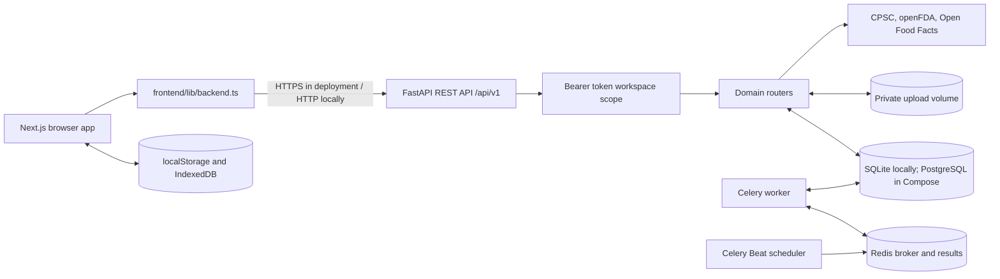

# Hackops-CR architecture, decisions, flows, and components

This document describes the implementation currently in this repository. It is a reference for the Next.js client, the optional FastAPI service, and the services used when running the full backend stack.

## Decisions

| Decision | Current implementation | Reason and trade-off |
| --- | --- | --- |
| Keep the browser usable without a server | The frontend uses browser storage when `NEXT_PUBLIC_BACKEND_URL` is unset. Configuring the URL enables backend sync and API-backed features. | Keeps the demo easy to run and allows progressive adoption of persistence. Local browser data is device-specific. |
| Use a private workspace token instead of account management | The API creates a random bearer token per workspace, returns it once, and stores only its SHA-256 digest. The browser stores the token in localStorage. | Provides a small authentication boundary without adding an account system. It is a single-device credential and does not protect against same-origin script access. |
| Scope stored records to a workspace | Cases, warranty items, documents, audits, activity, and notifications carry a workspace ID. API lookups check the authenticated workspace. | Prevents one workspace token from reading or changing another workspace's records. |
| Keep file bytes outside relational rows | SQLAlchemy stores file metadata and hashes; uploaded bytes live under the configured upload directory. PostgreSQL is used by Compose; SQLite is the local default. | Separates database and file storage concerns. A production deployment must back up both. |
| Use transparent, deterministic text analysis | Contract screening uses nine keyword rules; question answering returns exact matching sentences. Case amounts are arithmetic, and document drafts use templates. | Makes outputs inspectable and avoids implying that an unimplemented model or legal review is present. |
| Require user review before action | Notices and warranty requests are drafts. The backend does not send them, file claims, determine legal eligibility, or certify product safety. | Keeps consequential decisions and external communications with the user. |
| Queue reminders as records, not messages | Celery Beat schedules daily checks; worker tasks create in-app notification records in PostgreSQL. | Supports durable reminders without requiring an email or messaging provider. The worker and scheduler must be running. |
| Keep the API modular by domain | FastAPI routers separate workspaces, cases, warranties, documents, contracts, scans, and notifications. | Keeps request validation and workspace authorization close to each feature while sharing persistence and security helpers. |

## Architecture

### Runtime boundaries

- The browser presents the workspace and can retain local records and files. With a backend URL configured, it bootstraps a bearer-token workspace, migrates eligible local records, and uses the REST API for supported operations.
- The API is stateless between requests. The database, upload volume, and Redis queue hold persistent state. OpenAPI documentation is available at `/docs`.
- `docker-compose.yml` runs the API, PostgreSQL, Redis, one Celery worker, and Celery Beat. The API and worker share the evidence volume. Local development can use SQLite and a local upload directory.
- Product lookup calls public data sources from the backend. A missing match is not evidence that a product is safe or recall-free.

## Main flows

### Workspace startup and local data migration

1. The frontend reads its local workspace state and checks `NEXT_PUBLIC_BACKEND_URL`.
2. If configured, it reads the device's saved bearer token or creates a backend workspace and stores the returned token in localStorage.
3. It requests `GET /api/v1/workspace/snapshot` and migrates non-sample local cases, warranty items, and available evidence that are missing from that snapshot.
4. It fetches a fresh snapshot and maps the server records into the UI. Demonstration sample rows remain local and are not migrated.
5. Subsequent supported changes are sent to the API. Without the backend URL, the app stays in browser storage mode.

### Case intake and evidence

1. A user enters the consumer, merchant, product, dates, amounts, narrative, and any optional response-window details in the case form.
2. The API validates the request, scopes it to the bearer-token workspace, calculates the arithmetic estimate, and saves a reviewable Markdown notice. Interest defaults to zero; a response window is optional and user-entered.
3. Evidence uploads are size- and type-checked, written to private storage, hashed with SHA-256, and associated with the user's warranty item or case. Available PDF text extraction and image OCR are best-effort.
4. The case records a Merkle root over normalized case facts and attached evidence hashes. The user can download the notice as Markdown or PDF and review it before use.
5. If the user records a sent date and response period, the API records the resulting deadline. The scheduled task can create an in-app reminder when that date passes.

### Warranty and claim draft

1. The user creates or edits a warranty item with product, seller, purchase, and warranty-date details.
2. The user can attach receipts or other evidence; file metadata and hashes appear with the item.
3. The claim generator prepares an unsent service-request draft from the item, user-entered issue, and evidence inventory.
4. The user may copy a warranty item and its evidence into a new case draft for further review. No request is sent automatically.

### Contract screening and question lookup

1. The user submits pasted terms to `POST /api/v1/contracts/audit`.
2. The backend splits the text into numbered sentences and checks each against nine readable keyword patterns. It stores the source text, flags, score, and sentence IDs in the workspace.
3. A question to `POST /api/v1/contracts/chat` is matched lexically against those stored sentences. The response contains exact source sentences and their IDs; it does not generate an interpretation from a language model.

### Barcode and product lookup

1. The scanner or manual form provides a barcode and/or product name, brand, and model.
2. The backend validates GTIN length and check digit when a barcode is supplied.
3. It queries CPSC by product title and, for a valid GTIN, openFDA enforcement data and Open Food Facts. Source failures and no-match responses are represented separately.
4. The UI shows results with source links and a reminder to verify product identifiers and source details.

### Scheduled reminders

1. Celery Beat triggers the daily warranty-expiry and case-response checks.
2. A Celery worker queries PostgreSQL and creates workspace-scoped notification rows for matching dates.
3. The frontend reads and marks notifications through the API. These tasks create in-app records; they do not email or text users.

## Components

### Frontend

| Component | Responsibility |
| --- | --- |
| `frontend/app/` | Next.js routes for dashboard, command center, warranty vault, contract helper, product scan, research, and landing page. |
| `frontend/components/layout/Shell.tsx` | Shared application navigation and page shell. |
| `frontend/components/CaseForm.tsx` | Case facts and notice-draft intake. |
| `frontend/components/warranty/` | Warranty product forms, product passports, and claim-draft workflow. |
| `frontend/components/scanner/BarcodeCamera.tsx` | Browser barcode capture; the scan page also supports manual entry. |
| `frontend/lib/workspace.tsx` | Workspace state, local storage mode, backend bootstrap, local-record migration, and UI operations. |
| `frontend/lib/backend.ts` | API base URL, bearer-token creation/storage, authenticated requests, uploads, and downloads. |
| `frontend/lib/documents.ts` | Browser-side evidence metadata and IndexedDB file handling for local mode. |
| `frontend/lib/contracts.ts` | Client contract helpers and sample data used by the contract screen. |

### Backend

| Component | Responsibility |
| --- | --- |
| `backend/app/main.py` | FastAPI app lifecycle, CORS, response headers, health endpoints, and router registration. |
| `backend/app/security.py` | Workspace token creation, SHA-256 token hashing, and bearer-token authentication. |
| `backend/app/models.py`, `schemas.py`, `database.py` | SQLAlchemy tables, Pydantic request/response schemas, and database sessions. |
| `backend/app/api/auth.py`, `workspace.py` | Workspace lifecycle, snapshot, and dashboard endpoints. |
| `backend/app/api/cases.py` | Case intake, ownership checks, status updates, evidence attachment, calculations, and notice exports. |
| `backend/app/api/warranty.py` | Warranty item CRUD, evidence association, draft generation, and case escalation. |
| `backend/app/api/documents.py` | Upload validation/storage, hashes, best-effort text extraction, attachment, download, and cleanup. |
| `backend/app/api/contracts.py`, `backend/app/nlp/` | Contract audit persistence, keyword rules, sentence splitting, and extractive citation retrieval. |
| `backend/app/api/scan.py`, `backend/app/integrations/scan.py` | GTIN validation and public product/recall source requests. |
| `backend/app/api/notifications.py`, `backend/app/tasks/` | Notification reads/updates and scheduled database checks. |
| `backend/app/agents/` | Deterministic claim arithmetic, issue-spotting prompts, and notice templates; this is not a LangGraph or autonomous-agent runtime. |
| `backend/Dockerfile`, `docker-compose.yml` | Container image and local multi-service runtime. |

## Operational notes

- The application currently creates tables at startup with SQLAlchemy `create_all`; schema changes need a migration system before production use.
- Set `NEXT_PUBLIC_BACKEND_URL` to the deployed API origin and configure `CORS_ORIGINS` to the exact frontend origin. Use HTTPS, strong database credentials, managed secrets, backups for both database and uploads, and rate limiting for workspace creation in a public deployment.
- Optional OCR requires the relevant Python extras and a Tesseract installation. Failure to extract text does not prevent storing a supported evidence file.
- Workspace tokens are device credentials stored in localStorage. They can be revoked by deleting the workspace, which also deletes its records and stored files.
- The Compose defaults are for local development and must be changed before public deployment.
