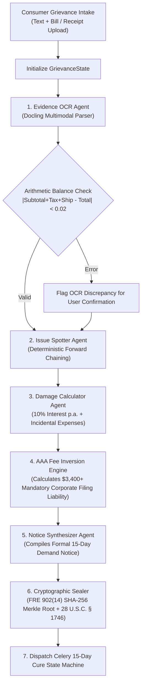

# Hackops-CR: Complete Technical Implementation Specification

> **A Production-Grade, Full-Stack Architectural Blueprint for Autonomous Consumer Rights Advocacy, Product Transparency, and Smart Warranty Management**  
> **Frontend:** Next.js 15 App Router (React 19, Tailwind CSS, Lucide, Recharts)  
> **Backend:** FastAPI, Python 3.12+, LangGraph Multi-Agent Engine, Celery, Redis, Docling OCR  
> **Theme:** Deep Abyss + Frosted Slate Bento Grid + Glassmorphic Editorial

---

## Current frontend milestone (2 November 2026)

The current frontend milestone remains local-first. The repository also includes a separately usable FastAPI backend with bearer-token workspaces, persistent case and warranty records, private evidence uploads, draft notice PDF generation, nine-category keyword contract screening, exact-sentence retrieval, CPSC/openFDA/Open Food Facts lookups, and Celery reminders. When `NEXT_PUBLIC_BACKEND_URL` is configured, the browser syncs cases, warranties, and evidence and uses the backend for contract and barcode lookups. It does not use LangGraph, Docling, a trained CLAUDETTE model, a generative LLM, email dispatch, or legal eligibility decisions.

- Landing page: EvolveAI-inspired floating pill navigation, oversized editorial typography, geometric hero, numbered sections, animated workspace counters, asymmetric bento previews, and expandable FAQ.
- Application: responsive sidebar, case ledger and draft export, local product passports and document locker, barcode validation, five-axis contract radar, and exact-sentence chat preview.
- Persistence: localStorage for workspace records; IndexedDB for document files. Initial records are clearly marked fictional samples.
- Backend capabilities: the REST service provides best-effort text extraction, keyword screening, public-source lookups, and user-reviewed PDF drafts. These features are informational and do not establish legal or product-safety conclusions.

### Approved palette override

This palette supersedes the earlier warm/amber examples throughout this specification.

| Role | Color | Hex |
|---|---|---|
| Canvas / background | Deep Abyss | `#0A0F1D` |
| Bento card surface | Frosted Slate | `#131B2E` |
| Card border | Slate | `#1E293B` |
| Primary text | Cold Platinum | `#F8FAFC` |
| Muted text / tags | Steel Mist | `#94A3B8` |
| Primary accent | Electric Cobalt | `#2563EB` |
| Secondary glow | Laser Cyan | `#06B6D4` |
| Alert / trap | Warning Coral | `#F43F5E` |

Typography uses bundled Inter and JetBrains Mono. The landing page adopts EvolveAI’s layout and visual rhythm using this approved palette.

---

## Table of Contents
1. [Executive Summary & Core Architectural Principles](#1-executive-summary--core-architectural-principles)
2. [Complete Monorepo Directory Layout](#2-complete-monorepo-directory-layout)
3. [Design System & UI Recreation Specifications](#3-design-system--ui-recreation-specifications)
4. [Phase-by-Phase Technical Implementation](#4-phase-by-phase-technical-implementation)
   - [Phase 1: Multi-Agent Redress Engine (Pillar 1: Command Center)](#phase-1-multi-agent-redress-engine-pillar-1-command-center)
   - [Phase 2: Barcode Intelligence & Blind Spot Engine (Pillar 2: Scan QR)](#phase-2-barcode-intelligence--blind-spot-engine-pillar-2-scan-qr)
   - [Phase 3: CLAUDETTE Contract Auditor & LexiBot (Pillar 3: Terms Agent)](#phase-3-claudette-contract-auditor--lexibot-pillar-3-terms-agent)
   - [Phase 4: Digital Warranty Vault & Lifecycle Locker (Pillar 4: Warranty Vault)](#phase-4-digital-warranty-vault--lifecycle-locker-pillar-4-warranty-vault)
5. [Data Schemas & Type Contracts](#5-data-schemas--type-contracts)
6. [REST API Specifications](#6-rest-api-specifications)
7. [Deployment, Task Queues & Security Hardening](#7-deployment-task-queues--security-hardening)
8. [Academic & Statutory Citation Matrix](#8-academic--statutory-citation-matrix)

---

## 1. Executive Summary & Core Architectural Principles

**Hackops-CR** is an autonomous, full-stack consumer defense platform built to eliminate the legal and informational asymmetries between individual retail shoppers and corporate enterprises. The platform is structured around three strict engineering principles:

```
┌────────────────────────────────────────────────────────────────────────────────────────┐
│                        CORE ENGINEERING PRINCIPLES                                    │
├────────────────────────────────────────────────────────────────────────────────────────┤
│ 1. Neuro-Symbolic Decoupling: LLMs extract factual predicates only (dates, amounts,   │
│    serial numbers). Legal statutory reasoning (UCC § 2-314, MMWA, ROSCA) and interest │
│    calculations are executed strictly by deterministic forward-chaining rule engines. │
│                                                                                        │
│ 2. Self-Authenticating Digital Evidence: Receipts, serial numbers, and demand notices  │
│    are bound into SHA-256 Merkle trees with unsworn 28 U.S.C. § 1746 declarations,    │
│    satisfying Federal Rules of Evidence FRE 902(14) for direct court docketing.        │
│                                                                                        │
│ 3. Economic Fee Inversion: Individual consumer arbitration (AAA / CPR) assesses        │
│    merchants $3,400+ in non-waivable fees per claim. Surfacing this pre-litigation     │
│    imposes decisive leverage to settle claims within the statutory 15-day cure window. │
└────────────────────────────────────────────────────────────────────────────────────────┘
```

---

## 2. Complete Monorepo Directory Layout

The platform is designed as a decoupled, production monorepo:

```text
consumer-rights-platform/
├── frontend/                     # Next.js 15 App Router (React 19, Tailwind CSS)
│   ├── app/
│   │   ├── page.tsx              # Landing Page (EvolveAI style + Asymmetric Bento Grid)
│   │   ├── layout.tsx            # Root layout with warm obsidian glassmorphic theme
│   │   ├── command-center/       # Pillar 1: Multi-Agent Hub & 15-Day Notice Generator
│   │   │   └── page.tsx          # Stockroom-style operational dispatch ledger
│   │   ├── scan/                 # Pillar 2: Barcode, Recalls & Shrinkflation Scanner
│   │   │   └── page.tsx          # Cruip Mosaic hardware-accelerated scanner view
│   │   ├── lexibot/              # Pillar 3: CLAUDETTE T&C Analyzer & Grounded Chatbot
│   │   │   └── page.tsx          # 5-Axis Risk Radar & verified citation drawer
│   │   ├── warranty-vault/       # Pillar 4: Digital Warranty Vault & Lifecycle Locker
│   │   │   └── page.tsx          # Product passport cards, countdown bars & claim wizard
│   │   ├── research/             # Academic corpus & statutory bibliography
│   │   │   └── page.tsx          # Searchable 21-paper citation repository
│   │   └── api/                  # Edge proxy routes streaming SSE to FastAPI backend
│   │       ├── cases/route.ts
│   │       ├── scan/route.ts
│   │       ├── contracts/route.ts
│   │       └── warranty/route.ts
│   ├── components/
│   │   ├── visualizers/          # Pure SVG / Recharts data visualizers
│   │   │   ├── RiskRadar.tsx     # 5-Axis CLAUDETTE Contract Risk Radar
│   │   │   └── ExpiryTimeline.tsx# Warranty Lifecycle & Expiry Countdown Bar
│   │   ├── scanner/              # ZXing WebRTC camera scanner & GS1 barcode parser
│   │   │   └── BarcodeCamera.tsx # 60fps GPU frame loop with W3C BarcodeDetector
│   │   ├── warranty/             # Digital Warranty Vault UI components
│   │   │   ├── ProductProfile.tsx# Digital product passport & repair history card
│   │   │   ├── ClaimWizard.tsx   # Authorized service channel & claim generator
│   │   │   └── DocLocker.tsx     # Drag-and-drop receipt, serial & invoice storage
│   │   ├── pdf/                  # @react-pdf/renderer dynamic court docket templates
│   │   │   └── StatutoryNoticePDF.tsx
│   │   ├── layout/               # Cruip Mosaic sleek sidebar & header components
│   │   │   ├── Sidebar.tsx       # Collapsible navigation with active glow lines
│   │   │   └── Header.tsx        # System status dot, search, and action triggers
│   │   └── ui/                   # Warm-minimalist glass cards, buttons, badges
│   │       ├── Card.tsx
│   │       ├── Button.tsx
│   │       └── Badge.tsx
│   ├── lib/                      # Client utilities, WebCrypto hashing & SSE hooks
│   │   ├── api-client.ts         # Type-safe Fetch wrapper with SSE stream parsing
│   │   └── merkle.ts             # WebCrypto SHA-256 Merkle root calculator
│   ├── package.json
│   ├── tailwind.config.ts
│   └── tsconfig.json
│
└── backend/                      # FastAPI Python Service (Python 3.12+)
    ├── app/
    │   ├── main.py               # FastAPI application entrypoint & middleware
    │   ├── api/                  # REST API route routers
    │   │   ├── cases.py          # Claim management & status endpoints
    │   │   ├── scan.py           # Barcode resolution & recall queries
    │   │   ├── contracts.py      # Terms of service analysis endpoints
    │   │   └── warranty.py       # Warranty vault, OCR ingestion & claim endpoints
    │   ├── agents/               # LangGraph Multi-Agent Workflows
    │   │   ├── state.py          # Central case state definition (GrievanceState)
    │   │   ├── orchestrator.py   # Main LangGraph graph coordinator & workflow DAG
    │   │   ├── issue_spotter.py  # UCC § 2-314 & MMWA statutory reasoning agent
    │   │   ├── evidence_ocr.py   # Docling multimodal receipt & serial parser
    │   │   ├── damage_calc.py    # 10% statutory pre-judgment interest calculator
    │   │   └── notice_drafter.py # Self-authenticating legal demand letter synthesizer
    │   ├── nlp/                  # Legal NLP models & heuristics
    │   │   ├── claudette.py      # CLAUDETTE 9-category contract classifier
    │   │   └── rag.py            # Sentence-chunked grounded RAG for LexiBot
    │   ├── integrations/         # Regulatory & manufacturer API clients
    │   │   ├── cpsc.py           # CPSC SaferProducts REST client
    │   │   ├── fda.py            # openFDA Enforcement API client
    │   │   ├── openfoodfacts.py  # Open Food & Products Facts v3 client
    │   │   ├── ifixit.py         # French Repairability Index & iFixit client
    │   │   └── service_network.py# Authorized manufacturer service network locator
    │   └── tasks/                # Celery / Redis asynchronous worker tasks
    │       ├── celery_app.py     # Celery app instance configured with Redis broker
    │       ├── cure_monitor.py   # Living 15-day cure window countdown state machine
    │       └── expiry_notifier.py# Automated warranty expiry alerts (30d / 7d / 24h)
    ├── pyproject.toml
    └── Dockerfile
```

---

## 3. Design System & UI Recreation Specifications

The visual identity is characterized as **Modern Warm-Minimalist + Bento Grid + Modern Glassmorphic Editorial**, harmonizing three primary design references:

### A. Design References
1. **Landing Page (`https://evolveai.chitkara.edu.in/`):**
   - High-contrast editorial hero typography (`Inter` / `Plus Jakarta Sans`).
   - Glowing badge pills (`bg-amber-500/10 text-amber-400 border border-amber-500/20`).
   - Real-time animated counters: Total Disputed Value, AAA Fees Avoided, Products Protected.
   - Asymmetric **Bento Grid** displaying interactive previews of the 4 defense pillars.
2. **Operations Dispatch Ledger (`https://uicookies.com/demo/#stockroom`):**
   - Clean, high-density inventory/dispatch ledger table aesthetic for the **Command Center**.
   - Metric KPI ribbon, quick intake forms with 60-second presets, and living 15-day statutory countdown status bars.
3. **Application Chrome & Feature Panels (`https://cruip.com/demos/mosaic/`):**
   - Sleek dark slate collapsible sidebar with categorized navigation and notification pills.
   - Interactive data visualizers: 5-Axis SVG Contract Risk Radar, Warranty Expiry Countdown Timelines, and grounded chatbot drawers with verified clause citations.

### B. Color Tokens & Theme Configuration
```typescript
// tailwind.config.ts color tokens
export const themeColors = {
  canvas: {
    bg: '#0A0F1D', // Deep Abyss
    subtle: '#131B2E', // Frosted Slate
  },
  card: {
    surface: 'rgba(19, 27, 46, 0.70)', // Frosted Slate with backdrop-blur-md
    border: '#1E293B', // Slate card border
    hoverBorder: 'rgba(6, 182, 212, 0.40)', // Laser Cyan hover glow
  },
  accent: {
    cobalt: '#2563EB', // Electric Cobalt: primary CTAs, active states, focus rings
    cyan: '#06B6D4', // Laser Cyan: scanner, radar, interactive pills
  },
  status: {
    active: '#06B6D4', // Laser Cyan: recorded coverage and activity
    attention: '#06B6D4', // Laser Cyan: reminders and response windows
    alert: '#F43F5E', // Warning Coral: risk flags and expired coverage
  },
  text: {
    primary: '#F8FAFC', // Cold Platinum
    secondary: '#CBD5E1', // Supporting body text
    muted: '#94A3B8', // Steel Mist: metadata and timestamps
    code: '#94A3B8', // Steel Mist: monospace metadata
  }
};
```

---

## 4. Phase-by-Phase Technical Implementation

### Phase 1: Multi-Agent Redress Engine (Pillar 1: Command Center)

#### 1.1 Architecture & Workflow DAG
The Command Center coordinates multiple LangGraph worker agents through a centralized, typed state:



#### 1.2 LangGraph State Definition (`backend/app/agents/state.py`)
```python
from typing import TypedDict, List, Optional
from datetime import date

class EvidenceItem(TypedDict):
    id: str
    filename: str
    file_type: str
    sha256_hash: str
    ocr_raw_text: str
    verified: bool

class StatutoryCause(TypedDict):
    statute_code: str         # e.g., "UCC-2-314", "MMWA-15-USC-2308", "ROSCA-15-USC-8403"
    statute_name: str         # e.g., "Implied Warranty of Merchantability"
    violation_summary: str
    statutory_cure_days: int   # 15 days standard
    statutory_interest_rate: float # 0.10 (10% p.a.)

class GrievanceState(TypedDict):
    case_id: str
    consumer_name: str
    consumer_address: str
    merchant_name: str
    merchant_registered_agent: str
    product_name: str
    model_number: Optional[str]
    serial_number: Optional[str]
    purchase_date: date
    defect_discovery_date: date
    purchase_price: float
    tax_paid: float
    shipping_paid: float
    incidental_expenses: float
    calculated_interest: float
    total_statutory_demand: float
    corporate_arbitration_fee_risk: float # $3,400.00
    evidence_dossier: List[EvidenceItem]
    causes_of_action: List[StatutoryCause]
    merkle_tree_root: str
    cure_window_deadline: date
    generated_notice_markdown: str
    current_status: str       # DRAFT | NOTICE_DISPATCHED | CURE_ACTIVE | SETTLED | DOCKET_READY
```

#### 1.3 Deterministic Rule Engine (`backend/app/agents/issue_spotter.py`)
```python
def evaluate_statutory_causes(state: GrievanceState) -> List[StatutoryCause]:
    causes = []
    days_to_defect = (state["defect_discovery_date"] - state["purchase_date"]).days

    # Rule 1: UCC § 2-314 Implied Warranty of Merchantability
    # Goods must be fit for ordinary purpose; standard implied duration is 1-4 years.
    if days_to_defect <= 1460: # Within 4-year statute of limitations (UCC § 2-725)
        causes.append({
            "statute_code": "UCC-2-314",
            "statute_name": "Implied Warranty of Merchantability (UCC § 2-314)",
            "violation_summary": (
                f"The product failed to fulfill its ordinary purpose after {days_to_defect} days. "
                "Any merchant disclaimer of implied warranties is legally invalid under the "
                "Magnuson-Moss Warranty Act, 15 U.S.C. § 2308(a)."
            ),
            "statutory_cure_days": 15,
            "statutory_interest_rate": 0.10
        })

    # Rule 2: Magnuson-Moss Warranty Act Repair Tie-Ins (15 U.S.C. § 2302(c))
    # Merchants cannot condition warranty on using proprietary parts or service.
    causes.append({
        "statute_code": "MMWA-15-USC-2302(c)",
        "statute_name": "Prohibition Against Anti-Competitive Repair Tie-Ins",
        "violation_summary": "Conditioning warranty repair on exclusive authorized services violates 15 U.S.C. § 2302(c).",
        "statutory_cure_days": 15,
        "statutory_interest_rate": 0.10
    })

    return causes
```

#### 1.4 Damage & Statutory Interest Calculator (`backend/app/agents/damage_calc.py`)
Pre-judgment statutory interest is calculated deterministically under legal formulas:
$$I = P \times \frac{0.10}{365} \times \Delta t$$
$$\text{Total Demand} = P + \text{Tax} + \text{Shipping} + I + \text{Incidental Expenses}$$

```python
def calculate_statutory_damages(state: GrievanceState) -> dict:
    purchase_price = state["purchase_price"] + state["tax_paid"] + state["shipping_paid"]
    elapsed_days = (date.today() - state["purchase_date"]).days
    
    # 10% annual statutory interest rate
    interest = round(purchase_price * (0.10 / 365.0) * elapsed_days, 2)
    incidentals = state.get("incidental_expenses", 18.50) # Standard certified mail incidentals
    total_demand = round(purchase_price + interest + incidentals, 2)
    
    return {
        "calculated_interest": interest,
        "incidental_expenses": incidentals,
        "total_statutory_demand": total_demand,
        "corporate_arbitration_fee_risk": 3400.00 # AAA Commercial Consumer Arbitration non-waivable business fee
    }
```

---

### Phase 2: Barcode Intelligence & Blind Spot Engine (Pillar 2: Scan QR)

#### 2.1 Hardware-Accelerated Scanner Pipeline (`components/scanner/BarcodeCamera.tsx`)
1. **Camera Stream:** Access WebRTC video device via `navigator.mediaDevices.getUserMedia({ video: { facingMode: 'environment', width: { ideal: 1920 } } })`.
2. **GPU Barcode Detection:** Prefer the native browser `window.BarcodeDetector` for 60fps hardware-accelerated processing; fallback to `@zxing/library` when unsupported.
3. **GS1 Digital Link URI Resolution:** Parse 2D GS1 DataMatrix barcodes:
   $$\text{URI} = \text{https://id.gs1.org}/01/\{\text{GTIN}\}/10/\{\text{LOT}\}/21/\{\text{SERIAL}\}$$

#### 2.2 Open Regulatory Integrations (`backend/app/integrations/`)
- **CPSC Recall API Client (`cpsc.py`):** Queries `https://www.saferproducts.gov/RestWebServices/Recall?format=json&RecallTitle={query}` to detect active safety recalls.
- **openFDA Enforcement API (`fda.py`):** Queries `https://api.fda.gov/food/enforcement.json?search=upc:{gtin}&limit=1` for Class I, II, or III recalls.
- **Open Food & Product Facts v3 (`openfoodfacts.py`):**
  - **Shrinkflation Detection:** Checks historical weight records. If package weight dropped by $\Delta W \ge 3.0\%$ while unit price remained constant or rose, flag as **Shrinkflation**.
  - **Skimpflation Detection:** Compares historical ingredient order using Rank-Biased Overlap (RBO). A drop in premium components constitutes deceptive product degradation.
- **French Repairability Index (`ifixit.py`):** Fetches the official 0–10 repair score from `data.gouv.fr/indicereparabilite` to assess spare parts availability, disassembly ease, and repair manual access.

#### 2.3 Consumer Transparency Scorecard Formula
The composite 0–100 transparency score is computed as:
$$\text{Score} = 0.30 \cdot S_{\text{Safety}} + 0.25 \cdot S_{\text{Purity}} + 0.15 \cdot S_{\text{Value}} + 0.15 \cdot S_{\text{Repair}} + 0.15 \cdot S_{\text{Corporate}}$$

---

### Phase 3: CLAUDETTE Contract Auditor & LexiBot (Pillar 3: Terms Agent)

#### 3.1 CLAUDETTE 9-Category Classifier (`backend/app/nlp/claudette.py`)
Classifies terms of service clauses across the 9 canonical predatory categories established by Lippi et al. (2019):
1. **Unilateral Change of Contract:** Modifying terms without notice.
2. **Unilateral Termination:** Suspending accounts or forfeiting balances without cause.
3. **Contract by Use:** Binding consumers merely through website visits.
4. **Limitation of Liability:** Disclaiming gross negligence or statutory damages.
5. **Indemnification:** Requiring consumers to cover company legal fees.
6. **Mandatory Arbitration:** Forcing dispute resolution outside public courts.
7. **Class Action Waiver:** Stripping rights to join aggregated redress.
8. **Jurisdiction Selection:** Forcing dispute venues in distant corporate states.
9. **Content & IP Licensing:** Irrevocable licenses to train AI models on private user uploads.

#### 3.2 Sub-Linear Risk Scoring
To prevent excessive sensitivity while penalizing multiple severe violations, each category penalty is computed with sub-linear logarithmic saturation:
$$\text{Penalty}_c = w_c \cdot \min\Big(100,\, 30 \cdot \ln(1 + n_c)\Big)$$
$$\text{Overall Fairness Score} = \max\Big(0,\, 100 - \sum_{c=1}^{9} \text{Penalty}_c\Big)$$

#### 3.3 Sentence-Grounding RAG & Anti-Hallucination Guard (`backend/app/nlp/rag.py`)
1. **Deterministic Segmentation:** Contracts are split into immutable numbered sentences (`[S-001]`, `[S-002]`).
2. **Hybrid Retrieval:** Dense embeddings (BGE-M3 / OpenAI `text-embedding-3-small`) combined with BM25 lexical keyword ranking.
3. **Verification Guardrail:** Before transmitting any LexiBot response to the client, an AST validator inspects the completion. Any statement lacking an exact, verbatim quotation anchor `[Clause X.X: "..."]` matching an ingested sentence ID is rejected and regenerated.

---

### Phase 4: Digital Warranty Vault & Lifecycle Locker (Pillar 4: Warranty Vault)

#### 4.1 Digital Locker & Multi-Modal Ingestion Pipeline
1. **Docling Neural OCR Ingestion:** Consumers upload a PDF bill, snap a photo of a receipt, or capture a serial barcode.
2. **Regular Expression Serial Extractor:** Auto-extracts hardware serials:
   $$\text{Regex} = \verb|\b[A-Z0-9]{8,16}\b|$$
3. **Metadata Mapping:** Automatically extracts Merchant, Purchase Date, Model Number, Line-Item Price, and Express Warranty Terms (e.g., "24 Months Limited", "AppleCare+").
4. **Cryptographic Sealing:** Documents are hashed via SHA-256 and stored in the user's permanent cryptographic evidence locker.

#### 4.2 Expiry Countdown State Machine & Notification Scheduler
The Celery worker (`backend/app/tasks/expiry_notifier.py`) executes scheduled cron checks across all vault records:
- **30-Day Warning:** Alerts consumer that coverage expires in 30 days. Recommends running a device hardware diagnostic.
- **7-Day Urgent Warning:** Highlights the final opportunity to file warranty repair claims before coverage lapses.
- **24-Hour Expiration Notice:** Final notification. Transitions product status to `expired` and shifts legal claim strategy to state implied warranty laws (UCC § 2-314).

#### 4.3 1-Click Warranty Claim Wizard & Command Center Escalation
1. **Statutory Eligibility Verification:** Verifies coverage dates against express warranty contracts and statutory protections under the **Magnuson-Moss Warranty Act (15 U.S.C. § 2302)**.
2. **Authorized Service Locator:** Resolves manufacturer-authorized repair endpoints (Apple Genius Bar, LG Premier Care, Sony DMPC Authorized Service).
3. **Claim Packet Assembly:** Bundles proof of purchase, serial number photo, defect statement, and statutory remedy demand into a single PDF docket.
4. **1-Click Command Center Escalation:** If the merchant or service center refuses warranty repair or delays beyond 30 days, one click exports the full case dossier directly into **Pillar 1's Command Center** to formulate an authoritative 15-day statutory pre-litigation demand letter!

---

## 5. Data Schemas & Type Contracts

### TypeScript Client Models (`frontend/lib/types.ts`)
```typescript
export interface WarrantyVaultItem {
  id: string;
  name: string;
  brand: string;
  category: string;
  modelNumber: string;
  serialNumber: string;
  purchaseDate: string; // ISO 8601 YYYY-MM-DD
  seller: string;
  purchasePrice: number;
  warrantyDurationMonths: number;
  warrantyType: string;
  warrantyExpiryDate: string;
  daysRemaining: number;
  status: 'active' | 'expiring_soon' | 'expired';
  progressPercent: number; // 0 to 100
  merkleRoot: string;
  documents: {
    name: string;
    size: string;
    type: 'Invoice' | 'Warranty Certificate' | 'Serial Photo' | 'Repair Receipt';
    verified: boolean;
    date: string;
  }[];
  serviceHistory: {
    date: string;
    title: string;
    provider: string;
    cost: string;
    notes: string;
  }[];
  authorizedService: {
    provider: string;
    contact: string;
    portal: string;
    slaNotice: string;
  };
}

export interface DisputeCase {
  id: string;
  merchant: string;
  registeredAgent: string;
  product: string;
  purchaseDate: string;
  defectDate: string;
  claimAmount: number;
  statutoryInterest: number;
  incidentalDamages: number;
  totalDemand: number;
  statute: string;
  arbitrationFeeRisk: number;
  status: 'Draft Notice' | 'Cure Window Active' | 'Refund Approved' | 'Docket Ready';
  daysRemaining: number;
  merkleRoot: string;
  narrative: string;
}
```

---

## 6. REST API Specifications

The FastAPI service exposes high-performance asynchronous endpoints:

```
┌────────┬─────────────────────────────────────┬────────────────────────────────────────────────────────┐
│ METHOD │ ROUTE                               │ DESCRIPTION                                            │
├────────┼─────────────────────────────────────┼────────────────────────────────────────────────────────┤
│ POST   │ /api/v1/cases/intake                │ Submit plain-text grievance; runs LangGraph workflow   │
│ GET    │ /api/v1/cases                       │ Fetch active disputes with 15-day cure window status   │
│ GET    │ /api/v1/cases/{id}/notice.pdf       │ Download court-ready FRE 902(14) demand letter PDF     │
│ POST   │ /api/v1/scan/lookup                 │ Resolve GTIN/UPC against CPSC, openFDA, and iFixit     │
│ POST   │ /api/v1/contracts/audit             │ Submit terms text or URL; returns CLAUDETTE scores     │
│ POST   │ /api/v1/contracts/chat              │ Grounded RAG query stream with verified citations      │
│ POST   │ /api/v1/warranty/ingest             │ Upload bill/receipt PDF; runs Docling neural OCR       │
│ GET    │ /api/v1/warranty/items              │ List user's Digital Warranty Vault products            │
│ POST   │ /api/v1/warranty/claim/generate     │ Compile Magnuson-Moss authorized claim packet          │
│ POST   │ /api/v1/warranty/claim/escalate     │ 1-Click transfer of vault item into Command Center     │
└────────┴─────────────────────────────────────┴────────────────────────────────────────────────────────┘
```

---

## 7. Deployment, Task Queues & Security Hardening

### 7.1 Celery + Redis Task Queue (`backend/app/tasks/`)
- **Worker Configuration:** Celery runs with Redis broker (`redis://localhost:6379/0`).
- **`tasks/cure_monitor.py`:** Living countdown state machine checking active 15-day cure deadlines daily at 00:00 UTC. When `days_remaining <= 0`, automatically transitions status to `DOCKET_READY` and synthesizes AAA individual arbitration demand filings.
- **`tasks/expiry_notifier.py`:** Daily cron job querying `WarrantyVaultItem` records with `days_remaining IN (30, 7, 1)`. Dispatches push notifications and email alerts.

### 7.2 Dockerfile for FastAPI Multi-Agent Service
```dockerfile
FROM python:3.12-slim

WORKDIR /app

RUN apt-get update && apt-get install -y --no-install-recommends \
    build-essential \
    curl \
    tesseract-ocr \
    libgl1 \
    && rm -rf /var/lib/apt/lists/*

COPY pyproject.toml .
RUN pip install --no-cache-dir poetry && \
    poetry config virtualenvs.create false && \
    poetry install --only main --no-interaction --no-ansi

COPY app/ ./app/

EXPOSE 8000

CMD ["uvicorn", "app.main:app", "--host", "0.0.0.0", "--port", "8000", "--workers", "4"]
```

---

## 8. Academic & Statutory Citation Matrix

| Module / Pillar | Paper / Statutory Authority | Author / Venue | Key Finding & Operational Implementation | Reference Link |
|---|---|---|---|---|
| **Command Center** | *Access to Consumer Remedies in the Squeaky Wheel System* | Amy J. Schmitz (*Pepperdine Law Review*) | Proves companies systematically settle only with aggressive consumers; automated statutory notices equalize power. | [Paper](https://digitalcommons.pepperdine.edu/plr/vol39/iss2/2/) |
| **Command Center** | *Mass Arbitration & Fee Inversion* | J. Maria Glover (*Stanford Law Review*) | Mandatory arbitration costs companies \$3,400+ per case; weaponizes fee liability to compel refunds. | [Paper](https://www.stanfordlawreview.org/print/article/mass-arbitration/) |
| **Command Center** | *The Fourth Party in Algorithmic Dispute Resolution* | Wing, Martinez, Katsh, & Rule (*Negotiation Journal*) | Establishes autonomous computational agents as a "Fourth Party" that diagnoses claims and structures redress. | [DOI](https://doi.org/10.1111/nejo.12350) |
| **Command Center** | *UCC § 2-314 & Implied Warranty of Merchantability* | American Law Institute & ULC | Imposes non-waivable statutory duty that sold goods must be fit for ordinary purpose. | [UCC § 2-314](https://www.law.cornell.edu/ucc/2/2-314) |
| **Command Center** | *28 U.S.C. § 1746 & FRE 902(14)* | Federal Rules of Evidence & U.S. Code | Permits unsworn digital declarations under penalty of perjury to self-authenticate digital records. | [FRE 902](https://www.law.cornell.edu/rules/fre/rule_902) |
| **Scan QR** | *The Market for "Lemons": Quality Uncertainty* | George A. Akerlof (*Quarterly Journal of Economics*) | Information asymmetry leads to adverse selection; instant barcode scanning collapses consumer search costs. | [DOI](https://doi.org/10.2307/1879431) |
| **Scan QR** | *Digital Product Passports for a Circular Economy (ESPR)* | European Union (*Regulation EU 2024/1781*) | Global standard for tracking product history, repairability, and instantaneous hazardous recall alerts via 2D barcodes. | [EUR-Lex](https://eur-lex.europa.eu/eli/reg/2024/1781/oj) |
| **Terms Agent** | *Project CLAUDETTE: Automated Unfair Clause Detection* | Lippi et al. (*Artificial Intelligence and Law*) | Benchmark machine learning taxonomy for classifying 9 categories of unfair terms in consumer contracts. | [DOI](https://doi.org/10.1007/s10506-019-09243-2) |
| **Terms Agent** | *The Cost of Reading Privacy Policies* | McDonald & Cranor (*I/S: Journal of Law and Policy*) | Quantified that reading policies takes 244 hours per year (\$365B economic friction); AI readers are essential. | [Paper](https://kb.osu.edu/handle/1811/72839) |
| **Terms Agent** | *Make Privacy Policies Longer and Appoint LLM Readers* | Pałka et al. (*Artificial Intelligence and Law 2025*) | Proves consumers should appoint dedicated AI reader agents to safeguard their rights rather than reading agreements. | [DOI](https://doi.org/10.1007/s10506-025-09442-0) |
| **Warranty Vault** | *Magnuson-Moss Warranty Act (15 U.S.C. §§ 2301–2312)* | U.S. Federal Trade Commission & Congress | Mandates clear warranty disclosure, bans deceptive warranty disclaimers (§ 2308), and outlaws repair tie-ins (§ 2302(c)). | [FTC Guidance](https://www.ftc.gov) |
| **Warranty Vault** | *UCC § 2-607(3)(a) & Evidence Preservation in Sales* | American Law Institute & ULC | Imposes strict burden on buyers to preserve purchase proof and provide timely notice of breach to preserve remedy. | [ALI UCC](https://www.law.cornell.edu/ucc/2/2-607) |
